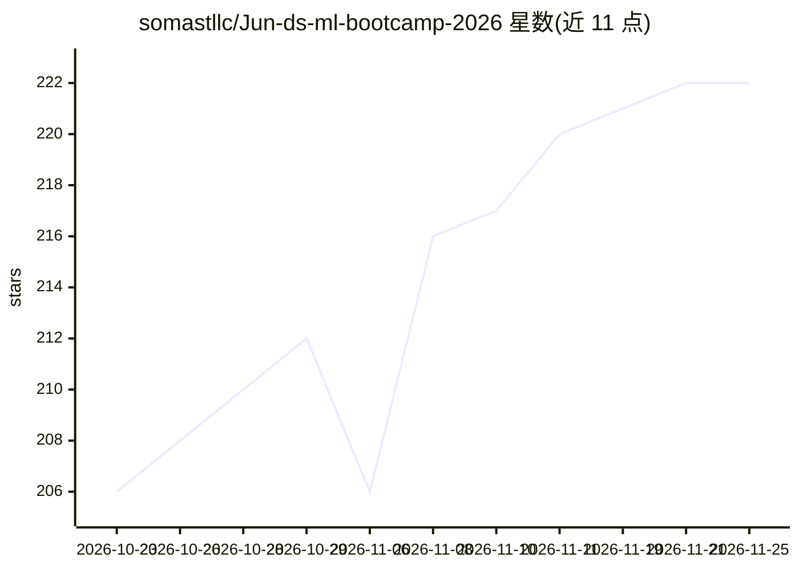

# somastllc/Jun-ds-ml-bootcamp-2026

⭐ 222 · Jupyter Notebook · NOASSERTION · 推送 2026-10-25 · [GitHub](https://github.com/somastllc/Jun-ds-ml-bootcamp-2026) · [官网](https://youtu.be/Ln9f16vI67U) · 组织维护

**一个月数据科学与机器学习训练营的课程资料库**

Somast 主办的为期一个月的数据科学与机器学习训练营配套仓库，收录课程代码示例与资源，按完整 ML 工作流组织：数据收集、预处理、训练/测试划分、模型选择、训练、评估与部署。课程以 YouTube 不公开视频形式发布，共 28 讲，涵盖回归、分类、聚类、部署及深度学习、生成式 AI、AI 伦理等加餐内容；可克隆仓库配合 Jupyter/VS Code 跟学。采用 CC BY-NC-SA 4.0 许可，仅限非商业使用。

## 筛选速览

| 维度 | 判定 | 备注 |
|---|---|---|
| AI 角色 | `ai-knowledge` | 知识聚合/清单类 |
| 许可风险 | `none` | NOASSERTION |
| 部署形态 | `None` |  |
| 模型依赖 | — | README 未给出锁定关系 |
| 硬件要求 | — | 无带数字的原话,不猜 |
| 安装摩擦 | `low` | 无编译、无系统依赖或容器化 |
| 成熟度 | — | 结构信号不足 |

## 能力要点

- 覆盖从数据收集到部署的完整 ML 工作流的课程内容
- 28 节 YouTube 视频课程，含理论、实践与作业
- 含深度学习、生成式 AI、AI 伦理与职业规划等加餐主题
- 可克隆仓库配合 Jupyter/VS Code 跟学

## 适用场景

- 零基础学习者按顺序跟随视频完成一个月 ML 入门
- 复现课程中的回归、分类、聚类实践代码
- 准备数据科学职业作品集时参考课程项目

## 场景标签

`教程课程` · 领域:学习与行业

## 证据(README 行号)

> L5: This repo contains all the lessons, code examples, and resources used during our one-month intensive bootcamp.
> L23: All lessons, assignments, and bonus sessions are available as **unlisted videos** on the **Somast YouTube Channel**
> L51: |24|Bonus — AI & Generative AI|▶️ Watch|

## 星数曲线

2026-10-23 206 → 2026-11-25 222（+16）

---
*卡片 v1 · prompt 1.4 · 生成 2026-11-25 · 置信度 high · 依据 README sha `2deba51f84a0` · [字段定义](../../DATASET.md)*
