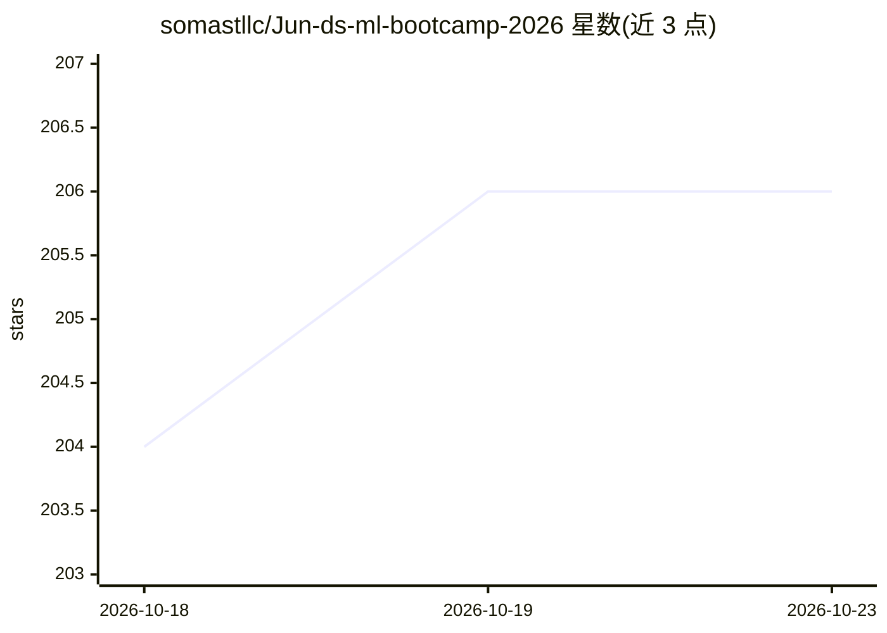

# somastllc/Jun-ds-ml-bootcamp-2026

⭐ 206 · Jupyter Notebook · NOASSERTION · 推送 2026-08-11 · [GitHub](https://github.com/somastllc/Jun-ds-ml-bootcamp-2026) · [官网](https://youtu.be/Ln9f16vI67U) · 组织维护

**一个月数据科学与机器学习训练营的课程代码与视频资源仓库**

Goobo Labs 主办的一个月密集型数据科学与机器学习训练营配套仓库，内容覆盖完整 ML 工作流（数据采集、预处理、训练测试划分、建模、评估、部署），包含 28 讲课程与作业，以 Goobo Labs YouTube 频道的未公开视频形式提供，另含数学基础、深度学习、生成式 AI、AI 伦理与职业发展等加课。仓库本身存放课程代码示例与资源，学习者克隆仓库后在 Jupyter/VS Code 中跟学。内容以 CC BY-NC-SA 4.0 许可发布，禁止商用。

## 筛选速览

| 维度 | 判定 | 备注 |
|---|---|---|
| AI 角色 | `ai-knowledge` | 知识聚合/清单类 |
| 许可风险 | `none` | NOASSERTION |
| 部署形态 | `None` |  |
| 模型依赖 | — | README 未给出锁定关系 |
| 硬件要求 | — | 无带数字的原话,不猜 |
| 安装摩擦 | `low` | 无编译、无系统依赖或容器化 |
| 成熟度 | — | 结构信号不足 |

## 能力要点

- 覆盖采集→预处理→建模→评估→部署的完整 ML 工作流课程
- 28 讲课程、作业与加课视频（YouTube 未公开列表）
- 含数学基础、深度学习、生成式 AI、AI 伦理等加课内容
- CC BY-NC-SA 4.0 非商用许可

## 适用场景

- 零基础学习者按顺序跟学一个月完成 DS/ML 入门
- 克隆仓库配合视频在 Jupyter/VS Code 中动手练习
- 查找回归、分类、聚类等主题的代码示例与作业

## 场景标签

 · 领域:教育/数据科学与机器学习

## 证据(README 行号)

> L5: This repo contains all the lessons, code examples, and resources used during our one-month intensive bootcamp.
> L23: All lessons, assignments, and bonus sessions are available as **unlisted videos** on the **Goobo Labs YouTube Chann

## 星数曲线

2026-10-18 204 → 2026-10-23 206（+2）

---
*卡片 v1 · prompt 1.4 · 生成 2026-10-22 · 置信度 high · 依据 README sha `268e7ab7b0e3` · [字段定义](../../DATASET.md)*
