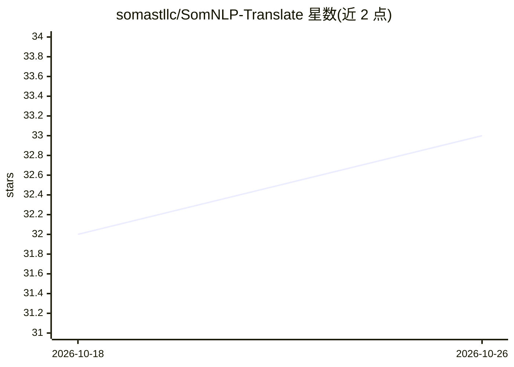

# somastllc/SomNLP-Translate

⭐ 33 · Rust · 推送 2026-07-22 · [GitHub](https://github.com/somastllc/SomNLP-Translate) · [官网](https://www.goobolabs.so) · 组织维护

**英索平行语料数据集项目：面向机器翻译的可复现数据管线**

SomNLP-Translate 是面向英语–索马里语机器翻译的平行数据项目，目标是构建可复现、带质量控制的平行语料及配套 Rust 数据管线（下载、清洗、双语种识别、过滤、去重、防泄漏切分）。当前仅完成 M1 基础阶段：数据契约与架构已定义，OPUS/MT560 下载器与各处理阶段仍在计划中，数据尚未发布。记录以方向无关的语言标签存储，导出时可生成双向训练视图。开发需 Rust 1.75+。

## 筛选速览

| 维度 | 判定 | 备注 |
|---|---|---|
| AI 角色 | `ai-knowledge` | 知识聚合/清单类 |
| 许可风险 | `none` | — |
| 部署形态 | `None` |  |
| 模型依赖 | — | README 未给出锁定关系 |
| 硬件要求 | — | 无带数字的原话,不猜 |
| 安装摩擦 | `low` | 无编译、无系统依赖或容器化 |
| 成熟度 | `idea` | |

## 能力要点

- 方向无关的记录格式：每对英索平行句只存一次，导出时生成双向训练视图
- 规划的 Rust 流式管线：清洗、双语 LID、质量过滤、近重去重与防泄漏切分
- 全流程保留被拒记录及机器可读的拒绝原因
- 与 SomNLP-Corpus 单语语料库配套，覆盖语言建模与翻译两类用途

## 适用场景

- 为英语–索马里语机器翻译训练与评测获取平行语料
- 为低资源语言 Somali 的 NLP/LLM 研究提供数据基础
- 复用其 Rust 流式数据管线处理其他平行语料

## 场景标签

 · 领域:NLP/机器翻译数据资源

## 证据(README 行号)

> L3:  Reproducible, quality-controlled English–Somali parallel data for machine translation.
> L35: SomNLP-Translate  aligned English–Somali pairs  → translation training and evaluation

## 星数曲线

2026-10-18 32 → 2026-10-26 33（+1）

---
*卡片 v1 · prompt 1.4 · 生成 2026-10-25 · 置信度 high · 依据 README sha `1d8c6de4f7a2` · [字段定义](../../DATASET.md)*
