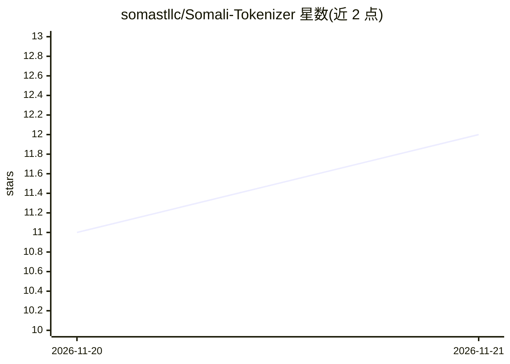

# somastllc/Somali-Tokenizer

⭐ 12 · Rust · Apache-2.0 · 推送 2026-11-19 · [GitHub](https://github.com/somastllc/Somali-Tokenizer) · [官网](https://huggingface.co/somast/somali-tokenizer) · 组织维护

**面向索马里语的 48k ByteLevel BPE 子词分词器**

用 Rust 实现并通过 PyO3 提供 Python 绑定的索马里语子词分词器，支持从版本化语料流式训练 ByteLevel BPE（48k 词表）、无损编解码往返、在保留集上评测 tokens per word 等指标。产物为标准 Hugging Face tokenizer.json，可直接被 transformers 加载。与通用分词器在索马里语文本上做压缩率对比。状态声明为已实现未发布：crates.io/PyPI 尚未上线，Python 包需经 maturin 从源码构建，全语料复测未完成。

## 筛选速览

| 维度 | 判定 | 备注 |
|---|---|---|
| AI 角色 | `ai-native` | 本体是模型或模型工具 |
| 许可风险 | `permissive` | Apache-2.0 |
| 部署形态 | `library` | 以包/库形式分发 |
| 模型依赖 | — | README 未给出锁定关系 |
| 硬件要求 | — | 无带数字的原话,不猜 |
| 安装摩擦 | `low` | 无编译、无系统依赖或容器化 |
| 成熟度 | `idea` | |

## 能力要点

- 48k ByteLevel BPE，含特殊 token 与 256 字节字母表，NFC 规范化
- decode(encode(x)) == NFC(x) 的无损往返保证
- 支持流式训练、评测基准、词表规模扫描，提供 Rust 库/CLI/Python 包三种形态
- 产物为标准 tokenizer.json，transformers 可直接加载

## 适用场景

- 为索马里语 LLM 预处理文本生成子词 token
- 在索马里语上对比不同分词器的碎片化程度
- 训练并发布版本化的索马里语分词器产物

## 场景标签

 · 领域:NLP/低资源语言工具

## 证据(README 行号)

> L3:  A research-grade subword tokenizer for the Somali language, implemented in Rust.
> L64: Somali-Tokenizer will be a Rust library and command-line tool for **training, evaluating,
> L68: It covers exactly one job: subword tokenization for language models and related NLP

## 星数曲线

2026-11-20 11 → 2026-11-21 12（+1）

---
*卡片 v1 · prompt 1.4 · 生成 2026-11-20 · 置信度 high · 依据 README sha `d06dddf53be1` · [字段定义](../../DATASET.md)*
