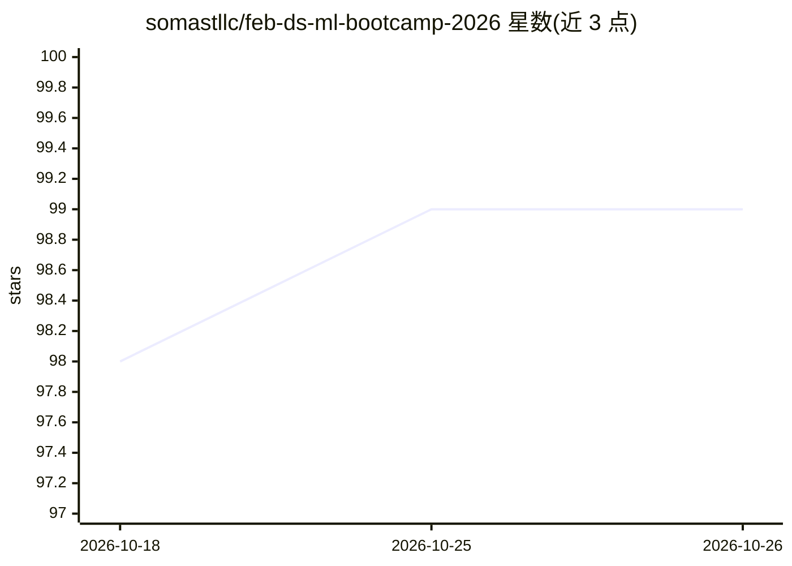

# somastllc/feb-ds-ml-bootcamp-2026

⭐ 99 · Jupyter Notebook · NOASSERTION · 推送 2026-10-25 · [GitHub](https://github.com/somastllc/feb-ds-ml-bootcamp-2026) · [官网](https://www.goobolabs.so) · 组织维护

**一个月 DS/ML 训练营课程仓库：课程视频与作业资源**

Goobo Labs 主办的一个月数据科学与机器学习训练营的课程资料仓库，包含 21 讲课程清单（含作业与最终项目），内容覆盖从数据采集、预处理、训练测试划分、模型选择、训练、评估到部署的完整 ML 工作流，涉及回归、分类、聚类等主题。课程以非公开 YouTube 视频形式交付，学习者可克隆仓库后在 Jupyter/VS Code 中跟练。资料按 CC BY-NC-SA 4.0 许可，仅限非商业使用。仓库本身不含可直接运行的软件产品。

## 筛选速览

| 维度 | 判定 | 备注 |
|---|---|---|
| AI 角色 | `ai-knowledge` | 知识聚合/清单类 |
| 许可风险 | `none` | NOASSERTION |
| 部署形态 | `None` |  |
| 模型依赖 | — | README 未给出锁定关系 |
| 硬件要求 | — | 无带数字的原话,不猜 |
| 安装摩擦 | `low` | 无编译、无系统依赖或容器化 |
| 成熟度 | — | 结构信号不足 |

## 能力要点

- 覆盖 ML 完整工作流的 7 步课程大纲
- 21 讲课程/作业/最终项目清单，视频托管于 YouTube
- 支持克隆仓库后用 Jupyter/VS Code 跟练

## 适用场景

- 按周跟学从零到上手的数据科学与机器学习课程
- 通过作业与最终项目练习回归、分类、聚类等主题
- 自学完整 ML 工作流：从数据采集到模型部署

## 场景标签

`教程课程` · 领域:学习与行业

## 证据(README 行号)

> L5: This repo contains all the lessons, code examples, and resources used during our one-month intensive bootcamp.
> L24: All lessons and assignments are available as **unlisted videos** on the Goobo Labs YouTube Channel.

## 星数曲线

2026-10-18 98 → 2026-10-26 99（+1）

---
*卡片 v1 · prompt 1.4 · 生成 2026-10-23 · 置信度 high · 依据 README sha `19188dc4ea3f` · [字段定义](../../DATASET.md)*
