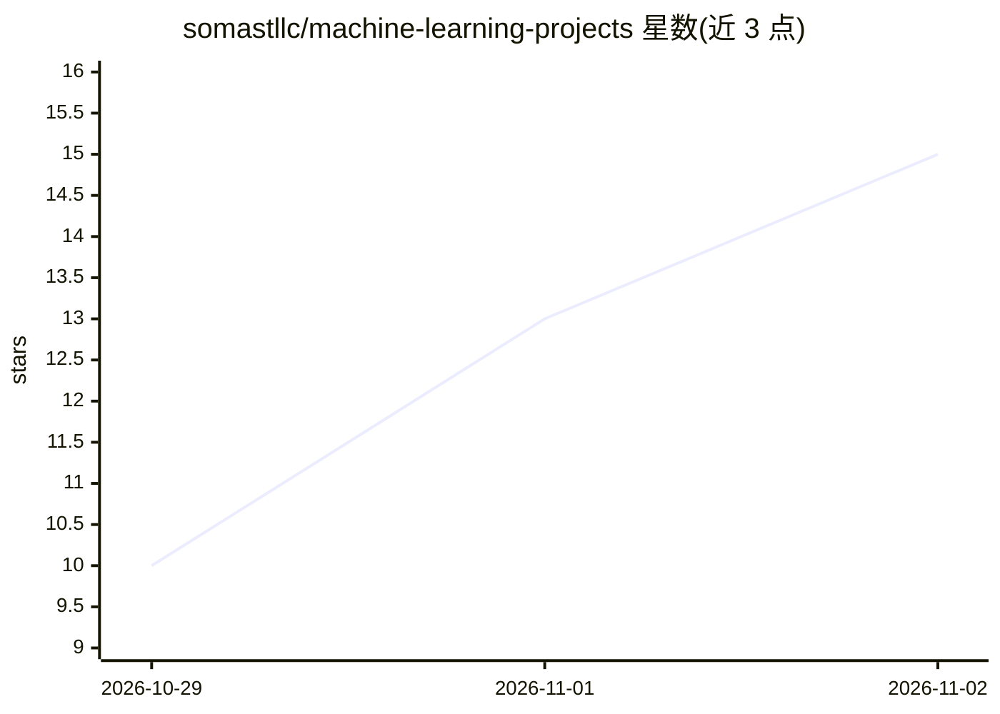

# somastllc/machine-learning-projects

⭐ 15 · Python · NOASSERTION · 推送 2026-10-26 · [GitHub](https://github.com/somastllc/machine-learning-projects) · [官网](https://youtu.be/Has3_C-tVP0?si=ohrtJdw_7oJiaUiX) · 个人维护

**Somast 的九个机器学习实战项目集：回归/分类/聚类**

包含九个实践项目的机器学习代码仓库，覆盖回归（卡路里、能耗、医保费用）、分类（网络入侵、学生辍学、心脏病风险）与聚类（客户、球员、手机用户细分）三个方向，每个方向各三个项目。各项目按共享结构组织：preprocessing.py 清洗编码、train.py 训练并保存模型、evaluate.py 评估、predict.py 预测，依赖各项目独立的 requirements.txt。用户在项目目录内创建 venv、按序运行脚本即可复现流程；各项目带专属 README 说明输入输出。

## 筛选速览

| 维度 | 判定 | 备注 |
|---|---|---|
| AI 角色 | `ai-native` | 本体是模型或模型工具 |
| 许可风险 | `none` | NOASSERTION |
| 部署形态 | `desktop` | 安装包/桌面程序 |
| 模型依赖 | — | README 未给出锁定关系 |
| 硬件要求 | — | 无带数字的原话,不猜 |
| 安装摩擦 | `low` | 无编译、无系统依赖或容器化 |
| 成熟度 | — | 结构信号不足 |

## 能力要点

- 九个项目覆盖回归、分类、聚类三类任务
- 统一目录结构：预处理/训练/评估/预测脚本分离
- 用 joblib 保存模型与预处理对象并复用于预测
- 每个项目有独立依赖与专属 README

## 适用场景

- 按项目练习从数据准备到预测的完整 ML 工作流
- 学习特征编码、缩放与特征交互等预处理技巧
- 对比 Linear Regression、Random Forest、K-Means 等模型效果

## 场景标签

`教程课程` · 领域:学习与行业

## 证据(README 行号)

> L3: Nine practical machine learning projects by **Somast**, covering regression, classification, and clustering. Each pr
> L37: |07|Mall Customer Segmentation|Group customers by income and spending patterns.|Scale features, fit K-Means, explor

## 星数曲线

2026-10-29 10 → 2026-11-02 15（+5）

---
*卡片 v1 · prompt 1.4 · 生成 2026-10-31 · 置信度 high · 依据 README sha `1597ff67551b` · [字段定义](../../DATASET.md)*
