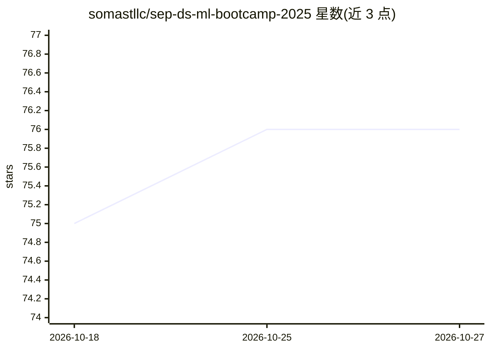

# somastllc/sep-ds-ml-bootcamp-2025

⭐ 76 · Jupyter Notebook · NOASSERTION · 推送 2026-10-25 · [GitHub](https://github.com/somastllc/sep-ds-ml-bootcamp-2025) · [官网](https://www.goobolabs.so) · 组织维护

**一个月期数据科学与机器学习训练营课程资料库**

Goobo Labs 主办的一个月密集型 DS/ML 训练营配套仓库，收录课程讲义、代码示例、作业与最终项目资源，主题覆盖 ML 介绍、数据处理、回归、分类、聚类与模型部署的完整工作流。课程以未公开 YouTube 视频形式发布，学习者可克隆仓库后在 Jupyter Notebook 或 VS Code 中跟随练习；仓库含 Anaconda 与 Jupyter 安装指引资源。内容以 CC BY-NC-SA 4.0 许可，限非商业使用，由个人贡献者维护，Dugsiiye 赞助。

## 筛选速览

| 维度 | 判定 | 备注 |
|---|---|---|
| AI 角色 | `ai-knowledge` | 知识聚合/清单类 |
| 许可风险 | `none` | NOASSERTION |
| 部署形态 | `None` |  |
| 模型依赖 | — | README 未给出锁定关系 |
| 硬件要求 | — | 无带数字的原话,不猜 |
| 安装摩擦 | `low` | 无编译、无系统依赖或容器化 |
| 成熟度 | — | 结构信号不足 |

## 能力要点

- 覆盖采集→预处理→训练→评估→部署的完整 ML 工作流课程
- 含 23 节课程/作业/资源条目及最终项目
- 提供 Anaconda 安装与 Jupyter Notebook 配置指引

## 适用场景

- 按顺序跟随视频自学数据科学与机器学习入门
- 获取回归、分类、聚类等主题的作业与练习材料
- 作为训练营讲师的课程资料分发仓库

## 场景标签

`教程课程` · 领域:学习与行业

## 证据(README 行号)

> L5: This repo contains all the lessons, code examples, assignments, and resources used during our one-month intensive bo
> L7: The program is designed to take participants from **zero to hands-on projects**, covering the full ML workflow:
> L24: All lessons and assignments are available as **unlisted videos** on the Goobo Labs YouTube Channel.

## 星数曲线

2026-10-18 75 → 2026-10-27 76（+1）

---
*卡片 v1 · prompt 1.4 · 生成 2026-10-24 · 置信度 high · 依据 README sha `ec5746f91b9a` · [字段定义](../../DATASET.md)*
