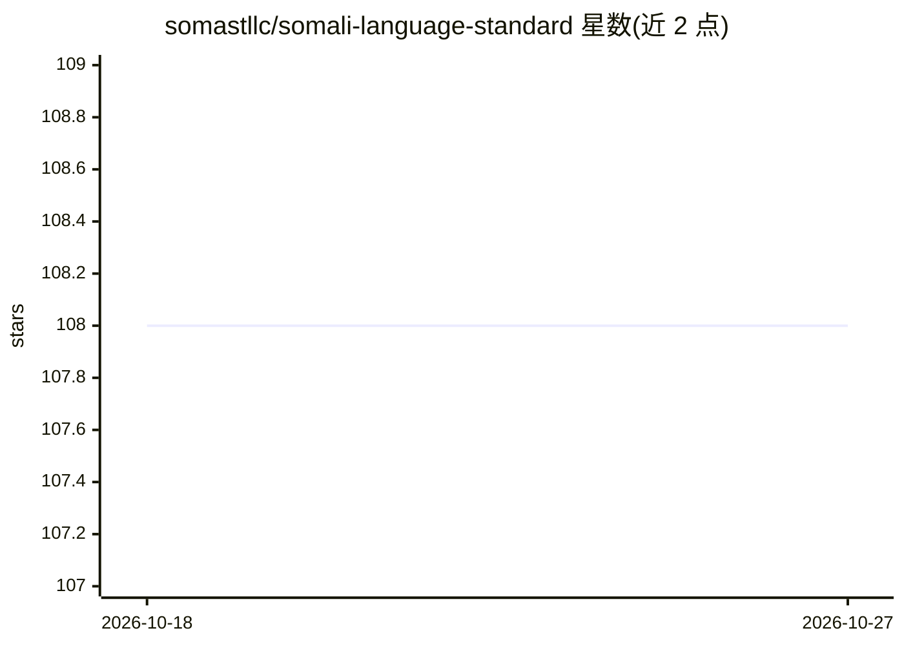

# somastllc/somali-language-standard

⭐ 108 · Rust · MIT · 推送 2026-10-25 · [GitHub](https://github.com/somastllc/somali-language-standard) · [官网](https://www.goobolabs.so) · 组织维护

**索马里语的开放机器可读语言标准（RFC 式规范目录）**

SLS 为索马里语定义正字法、语法、术语、翻译与 AI/基准资源的规范化标准：以带版本号、可引用的 RFC 式生命周期发布（SLS-XXXX 编号），所有数据以 JSONL 记录、经 schema 校验并带溯源。面向 AI 厂商、翻译系统、NLP 研究者、教育者与政府机构，提供术语治理程序、平行翻译对、指令数据集与评测套件（两者分离以防污染）。当前无标准达到 Stable，多数处于 Proposed/Review 阶段，配套 Rust 仓库校验器与 PR 校验流程。

## 筛选速览

| 维度 | 判定 | 备注 |
|---|---|---|
| AI 角色 | `ai-knowledge` | 知识聚合/清单类 |
| 许可风险 | `permissive` | MIT |
| 部署形态 | `None` |  |
| 模型依赖 | — | README 未给出锁定关系 |
| 硬件要求 | — | 无带数字的原话,不猜 |
| 安装摩擦 | `low` | 无编译、无系统依赖或容器化 |
| 成熟度 | `idea` | |

## 能力要点

- RFC 式编号标准目录（SLS-XXXX），支持精确合规声明
- 全部数据 JSONL、schema 校验、带溯源
- 评测套件与指令数据集严格分离以防污染
- 术语治理程序覆盖 AI、医学、法律等 20 个领域

## 适用场景

- 为索马里语 NLP 系统提供可实现的规范性语言标准
- 为 AI 厂商与翻译系统提供术语与正字法权威参照
- 构建索马里语评测基准并防止数据污染

## 场景标签

`模型评测` · 领域:评测与运维

## 证据(README 行号)

> L5: SLS defines grammar, orthography, terminology, translation guidance, style
> L44: - **AI resources and benchmarks**: prompts, instruction datasets, and

## 星数曲线

2026-10-18 108 → 2026-10-27 108（+0）

---
*卡片 v1 · prompt 1.4 · 生成 2026-10-23 · 置信度 high · 依据 README sha `3b3db9ce25e6` · [字段定义](../../DATASET.md)*
