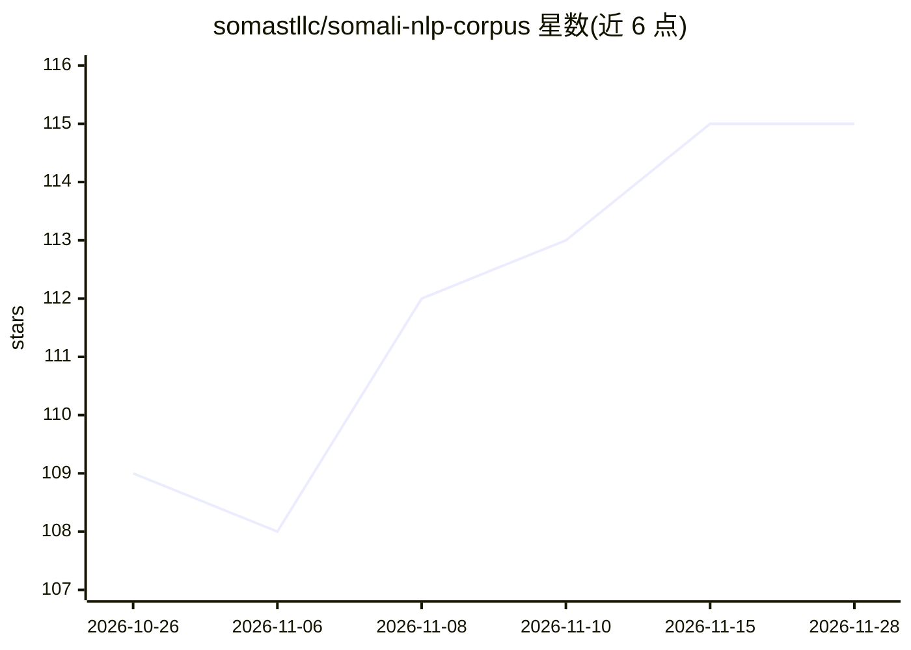

# somastllc/somali-nlp-corpus

⭐ 115 · Rust · 推送 2026-11-19 · [GitHub](https://github.com/somastllc/somali-nlp-corpus) · [官网](https://huggingface.co/datasets/somast/somali-nlp-corpus) · 组织维护

**索马里语文本语料库与数据处理管线，面向 NLP 研究**

由 Rust 编写的可复现数据处理管线：从 HPLT、CC100、mC4、OPUS 等 14 个公开来源下载索马里语文本，经合并去重、规范化、语言识别、MinHash/LSH 近似去重等阶段，输出训练用 JSONL 并生成逐记录来源与许可证元数据。1.0.0 版含 791 万文档、约 8.3 亿词。配套的 ByteLevel BPE 分词器独立维护在 Somali-Tokenizer 仓库，语料成品发布在 Hugging Face（gated 数据集）。完整构建需约 45 GB 磁盘、Rust 1.75+ 及 Hugging Face token。

## 筛选速览

| 维度 | 判定 | 备注 |
|---|---|---|
| AI 角色 | `ai-knowledge` | 知识聚合/清单类 |
| 许可风险 | `none` | — |
| 部署形态 | `library` | 以包/库形式分发 |
| 模型依赖 | — | README 未给出锁定关系 |
| 硬件要求 | — | 无带数字的原话,不猜 |
| 安装摩擦 | `medium` | 含编译或系统依赖之一 |
| 成熟度 | — | 结构信号不足 |

## 能力要点

- 14 个公开来源的下载器与流式处理管线，输出训练用 JSONL
- 逐记录携带来源、许可证、哈希与去重元数据
- 按记录自身许可证导出 open 与 non-commercial 两档 Parquet
- 配套 48k ByteLevel BPE 分词器（独立仓库，含 Rust/CLI/Python 包）

## 适用场景

- 为低资源语言（索马里语）模型训练准备清洗后的语料
- 研究数据管线中的去重、语言识别与许可分层方法
- 在 Hugging Face 上下载带逐记录许可信息的索马里语数据集

## 场景标签

 · 领域:NLP/语言资源

## 证据(README 行号)

> L3:  A reproducible Somali text corpus and data-processing pipeline for NLP and language-model research.
> L8: Somali NLP Corpus downloads public Somali datasets, normalizes and filters their text,
> L16: Version **1.0.0** is the build of **2026-10-19**, combining **14 public sources**:

## 星数曲线

2026-10-26 109 → 2026-11-28 115（+6）

---
*卡片 v1 · prompt 1.4 · 生成 2026-11-28 · 置信度 high · 依据 README sha `cc81d8e9d4b5` · [字段定义](../../DATASET.md)*
