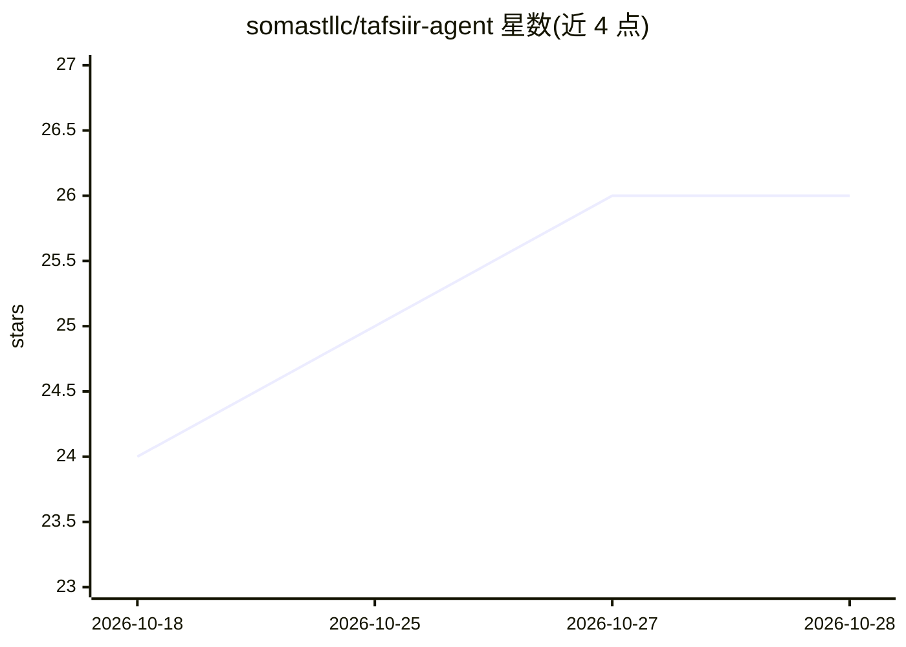

# somastllc/tafsiir-agent

⭐ 26 · TypeScript · MIT · 推送 2026-03-05 · [GitHub](https://github.com/somastllc/tafsiir-agent) · [官网](https://tafsiir.omartood.com/) · 个人维护

**面向索马里社区的古兰经索语注释 AI 问答助手**

基于 RAG 的古兰经索马里语 Tafsiir（注释）问答应用：以 data/trained.json 为语义记忆源，用 gemini-embedding-001 做语义检索，Memvid 提供向量相似度与词法匹配的混合检索，回答限定在所提供的 Tafsiir 数据内；生成模型为 Google Gemini 2.0 Flash。当前注释范围优化为 Al-Fatiha 与第 30 卷（Juz Amma），架构声称支持全部 114 章。另提供访问古兰经（阿拉伯语+索语译文）的公共 REST API。需 Node.js 18+ 与 Gemini API Key，经 git clone、npm install、npm run ingest 与 npm run dev 运行。

## 筛选速览

| 维度 | 判定 | 备注 |
|---|---|---|
| AI 角色 | `ai-native` | 本体是模型或模型工具 |
| 许可风险 | `permissive` | MIT |
| 部署形态 | `library` | 以包/库形式分发 |
| 模型依赖 | — | README 未给出锁定关系 |
| 硬件要求 | — | 无带数字的原话,不猜 |
| 安装摩擦 | `low` | 无编译、无系统依赖或容器化 |
| 成熟度 | — | 结构信号不足 |

## 能力要点

- gemini-embedding-001 语义嵌入 + Memvid 混合检索（向量+词法）
- 回答严格限定在提供的 Tafsiir 数据内，上下文缺失时不作答
- 当前聚焦 Al-Fatiha 与第 30 卷，架构支持扩展至全部 114 章
- 提供古兰经内容公共 REST API（阿拉伯语+索语译文）

## 适用场景

- 索马里语用户查询古兰经注释获得有出处的回答
- 通过 API 程序化访问古兰经经文与索语译文
- 作为索马里 AI 社区的宗教知识检索应用部署

## 场景标签

`文档问答` · 领域:知识与检索

## 证据(README 行号)

> L12: An AI-powered Somali Quran Tafsiir assistant that provides grounded, accurate answers from Somali Quranic interpret
> L27: - **🛡️ Hallucination-Free**: strictly grounded in provided tafsiir data. If the information isn't in the context, t
> L35: - **Intelligence**: Google Gemini 2.0 Flash

## 星数曲线

2026-10-18 24 → 2026-10-28 26（+2）

---
*卡片 v1 · prompt 1.4 · 生成 2026-10-26 · 置信度 high · 依据 README sha `d8a6887b5e40` · [字段定义](../../DATASET.md)*
