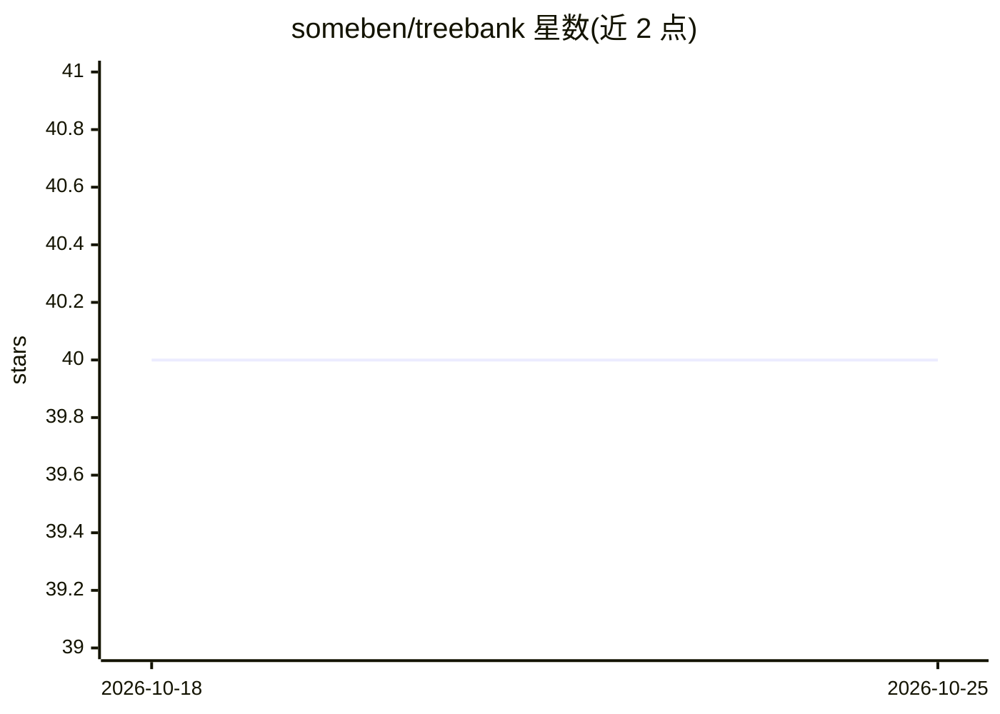

# someben/treebank

⭐ 40 · Ruby · Apache-2.0 · 推送 2026-10-13 · [GitHub](https://github.com/someben/treebank) · [官网](https://blog.someben.com/) · 个人维护

**Ruby 加载 SST 情感树库与 word2vec 索引的科研工具库**

Ruby 工具库，读取斯坦福情感树库（SST）的五个管道分隔文件与父指针编码，重建每句的句法分析树并输出短语到情感分数的映射，可将树渲染为按情感灰度着色的 SVG。另含一个脚本，读取二进制 word2vec 模型并生成字词字节偏移加 10 位局部敏感哈希的 JSON 索引，支持不加载整个模型即可查询单词向量或近邻。面向 NLP/机器学习科研用户，需自行下载 SST 数据并安装 ruby-graphviz、gsl 等 gem。项目写于 2013 年。

## 筛选速览

| 维度 | 判定 | 备注 |
|---|---|---|
| AI 角色 | `ai-knowledge` | 知识聚合/清单类 |
| 许可风险 | `permissive` | Apache-2.0 |
| 部署形态 | `None` |  |
| 模型依赖 | — | README 未给出锁定关系 |
| 硬件要求 | — | 无带数字的原话,不猜 |
| 安装摩擦 | `low` | 无编译、无系统依赖或容器化 |
| 成熟度 | — | 结构信号不足 |

## 能力要点

- 重建 SST 解析树并输出短语情感映射（11,855 句影评）
- 树渲染为按情感灰度着色的 SVG
- word2vec 二进制模型的 10 位 LSH 索引，可不载入内存查询向量与近邻

## 适用场景

- 加载 SST 数据做情感分析研究
- 对大规模 word2vec 模型做低内存的向量查找

## 场景标签

 · 领域:NLP/机器学习数据工具

## 证据(README 行号)

> L3: Ruby tools for the Stanford Sentiment Treebank
> L16: |`src/_stanford_sentiment_treebank.rb`|Loads the SST, rebuilds each sentence's parse tree, and yields phrase-to-sen
> L17: |`src/build_word2vec_index.rb`|Reads a binary word2vec `.bin` file and writes a JSON index of each word's byte offs

## 星数曲线

2026-10-18 40 → 2026-10-25 40（+0）

---
*卡片 v1 · prompt 1.4 · 生成 2026-10-25 · 置信度 high · 依据 README sha `e9cbba7c5458` · [字段定义](../../DATASET.md)*
