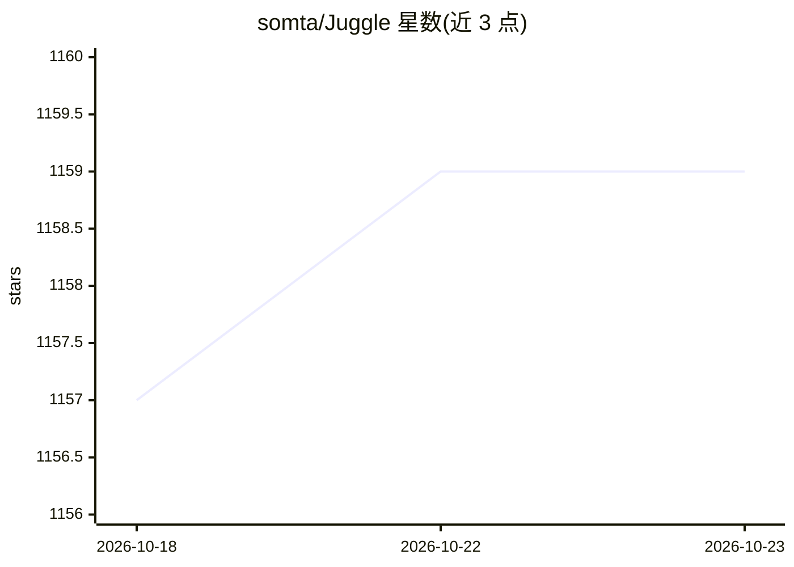

# somta/Juggle

⭐ 1,159 · Java · GPL-3.0 · 推送 2026-09-14 · [GitHub](https://github.com/somta/Juggle) · [官网](https://www.juggle.plus) · 组织维护 · 中文 README

**零代码/低代码的微服务接口编排与系统集成平台**

面向后端开发者的接口编排低代码平台：通过可视化流程将多个 API（HTTP/Dubbo/WebService）编排为复合接口，供前端直接调用或作为 BFF 层；内置方法、判断、循环、并行、代码、数据库、缓存等节点，支持 Groovy/JavaScript/Python/Java 脚本增强，支持 MySQL、达梦、TiDB 等近十款数据库，提供套件市场（含通义千问、钉钉机器人等）。流程分同步、异步、定时、监听四种类型。运行依赖 JDK 21，下载 zip 包解压后通过脚本启动。

## 筛选速览

| 维度 | 判定 | 备注 |
|---|---|---|
| AI 角色 | `ai-enhanced` | 去掉 AI 部分产品仍成立 |
| 许可风险 | `viral` | GPL-3.0 |
| 部署形态 | `None` |  |
| 模型依赖 | — | README 未给出锁定关系 |
| 硬件要求 | — | 无带数字的原话,不猜 |
| 安装摩擦 | `medium` | 含编译或系统依赖之一 |
| 成熟度 | — | 结构信号不足 |

## 能力要点

- 可视化流程编排，支持 HTTP/Dubbo/WebService 协议接口调用
- 方法/判断/循环/并行/代码/数据库/缓存/队列等多种节点类型
- 支持 Groovy/JavaScript/Python/Java 脚本语言增强流程
- 套件市场含通义千问、钉钉机器人、阿里云短信等系统套件

## 适用场景

- 已有微服务能力，通过编排快速搭建新产品
- 与第三方系统对接，无需开发完成集成
- 作为前端的适配层（BFF），替代 Node.js 自建 BFF
- 私有化或大量定制场景下编排定制接口，避免污染标准代码

## 场景标签

`工作流自动化` · 领域:效率与自动化

## 证据(README 行号)

> L9: Juggle是一个接口编排的低代码工具，通过它可以快速将简单的API编排成一个复杂的接口，编排的接口可以直接给前端使用，极大的提高开发效率，减轻开发成本。
> L36: 6.套件市场拥有几十个常见系统的官方套件（如：通义千问，钉钉机器人，QQ邮箱，阿里云短信）等，开箱即用，大大降低流程设计的复杂度

## 星数曲线

2026-10-18 1,157 → 2026-10-23 1,159（+2）

---
*卡片 v1 · prompt 1.4 · 生成 2026-10-21 · 置信度 high · 依据 README sha `45de68b062d6` · [字段定义](../../DATASET.md)*
