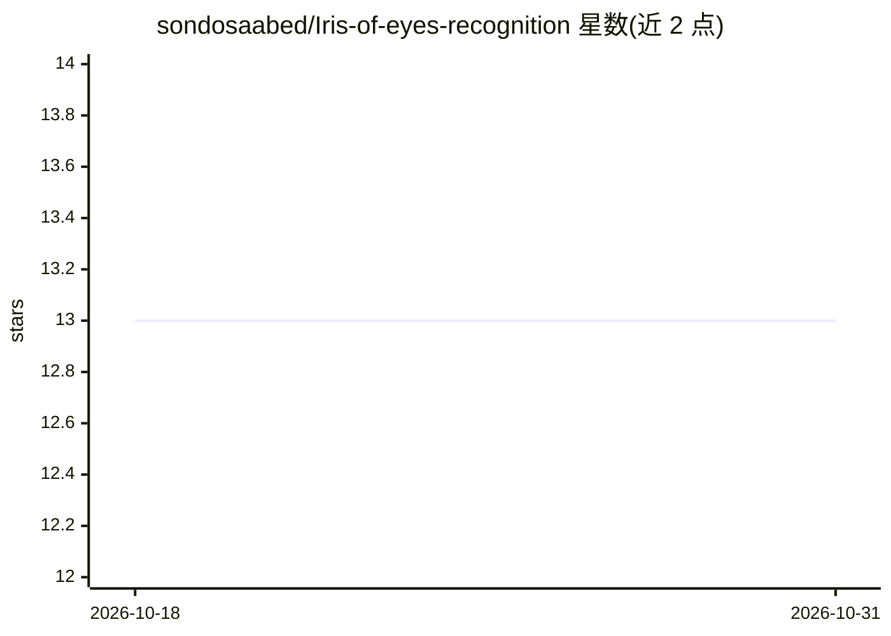

# sondosaabed/Iris-of-eyes-recognition

⭐ 13 · Jupyter Notebook · MIT · 推送 2026-09-19 · [GitHub](https://github.com/sondosaabed/Iris-of-eyes-recognition) · [官网](https://www.researchgate.net/publication/382794767_An_End-to-end_segmentation-free_approach_for_Iris_eye_Recognition?channel=doi&linkId=66ac01b48f7e1236bc2eb676&showFulltext=true) · 个人维护

**免分割的端到端虹膜识别生物认证项目（CNN+安卓App）**

基于 CASIA-Iris-Thousand 数据集（20,000 张近红外虹膜图像、2,000 个类别）训练的端到端、免分割虹膜识别系统：仅做灰度读取、150×150 缩放与归一化，直接输入 7 层 CNN（370 万参数）做 2,000 类分类，测试准确率 92.5%，并计算 FMR/FNMR/ROC/EER 等生物识别指标。模型导出为 TensorFlow Lite 部署到安卓应用 IrisRecognizer，提供注册与认证两个模块。仓库以 Jupyter notebook 形式交付，需自行获取数据集；README 自述存在过拟合、数据集族群偏差、闭集分类器无法拒识等限制，注册重训与 TFLite 转换部分未完成。

## 筛选速览

| 维度 | 判定 | 备注 |
|---|---|---|
| AI 角色 | `ai-native` | 本体是模型或模型工具 |
| 许可风险 | `permissive` | MIT |
| 部署形态 | `library` | 以包/库形式分发 |
| 模型依赖 | — | README 未给出锁定关系 |
| 硬件要求 | — | 无带数字的原话,不猜 |
| 安装摩擦 | `low` | 无编译、无系统依赖或容器化 |
| 成熟度 | — | 结构信号不足 |

## 能力要点

- 免分割端到端方案：轻预处理后直接输入 CNN
- 92.5% 测试准确率，含 FMR/FNMR/ROC/EER 生物识别指标评估
- 模型导出 TensorFlow Lite 并部署安卓应用（注册/认证流程）
- README 列出过拟合、数据集偏差、闭集分类等限制

## 适用场景

- 学习无分割虹膜识别的端到端 CNN 实现流程
- 复现 Kaggle 上的虹膜识别训练与评估 notebook
- 参考将分类模型转为 TFLite 并接入安卓认证应用的方案

## 场景标签

 · 领域:计算机视觉/生物识别

## 证据(README 行号)

> L9: ### Your eye is your password. Can a CNN read it with no segmentation at all?
> L10: **One CNN, 2,000 identities, 92.5% test accuracy, deployed to an Android app as TensorFlow Lite.**
> L122: |**Accuracy** (2,000-way)|**92.5%**|

## 星数曲线

2026-10-18 13 → 2026-10-31 13（+0）

---
*卡片 v1 · prompt 1.4 · 生成 2026-10-31 · 置信度 mid · 依据 README sha `23e517bd0205` · [字段定义](../../DATASET.md)*
