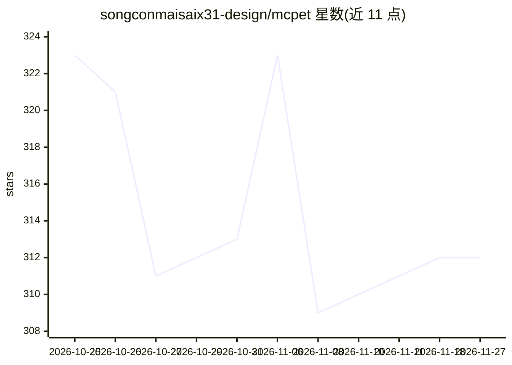

# songconmaisaix31-design/mcpet

⭐ 312 · Python · 推送 2026-11-17 · [GitHub](https://github.com/songconmaisaix31-design/mcpet) · [官网](https://github.com/songconmaisaix31-design/mcpet/releases) · 个人维护 · 中文 README

**监测 Agent 会话与本机用量的桌宠，附带餐饮提醒工具**

由桌宠桌面程序与一个 MCP 服务组成，共用同一份数据目录：桌宠动画跟随从日志与宿主事件读取的 Agent 会话状态，本地台账记录 token 用量与余额，并按计划触发饭点/咖啡提醒。通过 MCP stdio 接入支持该协议的 Agent 宿主，餐饮相关功能（麦当劳优惠券、瑞幸预览、营养记账）需自备凭据且下单有确认步骤与金额护栏。v0.1.0 仅提供 Windows x64 便携包，macOS/Linux 只有 Agent 路径可用；仓库根目录无项目级许可。

## 筛选速览

| 维度 | 判定 | 备注 |
|---|---|---|
| AI 角色 | `ai-ecosystem` | LLM/agent 周边工具 |
| 许可风险 | `none` | — |
| 部署形态 | `desktop` | 安装包/桌面程序 |
| 模型依赖 | — | README 未给出锁定关系 |
| 硬件要求 | — | 无带数字的原话,不猜 |
| 安装摩擦 | `low` | 无编译、无系统依赖或容器化 |
| 成熟度 | — | 结构信号不足 |

## 能力要点

- 桌宠动画跟随可读的 Agent 会话状态，idle/Stop 显示为会话状态而非成功
- MCP 服务以 stdio 接入宿主，提供会话状态、用量台账、餐饮、提醒等工具
- 下单/领券/记账需显式确认，默认护栏单笔 100 元、每日 3 单
- 本地台账每个数字带来源与更新时间

## 适用场景

- 在桌面直观查看长时间 Agent 运行处于工作/等输入/已停止哪种状态
- 集中查看本机 token 用量与 DeepSeek 余额
- 让 Agent 宿主代查麦当劳优惠并记录营养摄入

## 场景标签

`LLM 可观测性` `AI 助手` · 领域:对话与助手

## 证据(README 行号)

> L26: |**Fix 做法**|A desktop pet + an MCP server over one shared data directory: session state drives the animation, a loc
> L73: |**Host**|`src/agent_mcp.py`, `src/agent_install.py`|The MCP server is started by the host over stdio; the desktop 
> L88: The host needs MCP stdio support. From the agent package directory, or from a source checkout:

## 星数曲线

2026-10-25 323 → 2026-11-27 312（-11）

---
*卡片 v1 · prompt 1.4 · 生成 2026-11-25 · 置信度 low · 依据 README sha `ddebcc374f67` · [字段定义](../../DATASET.md)*
