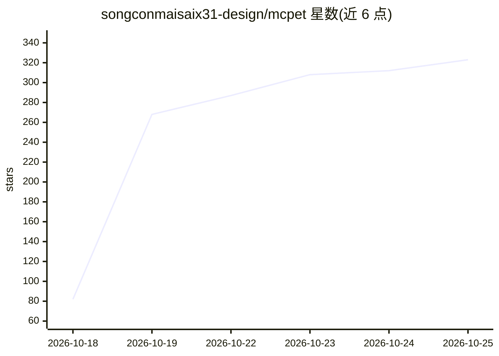

# songconmaisaix31-design/mcpet

⭐ 321 · Python · 推送 2026-10-16 · [GitHub](https://github.com/songconmaisaix31-design/mcpet) · 个人维护 · 中文 README

**麦当劳主题 AI 桌宠：盯 Agent 进度与 token 余额，提醒干饭查券**

基于 Python/PySide6 的 Windows 桌面宠物：提供陪伴动画与角色换装（DeepSeek 娘/ChatGPT 娘、麦麦套装），可查看已接入日志的 Agent 会话进度、本机 token 台账与 DeepSeek 官方余额；内置麦当劳优惠券/门店/订单、瑞幸下单取餐、营养记账与定时提醒，领券下单前需明确确认并带单笔 100 元/每日 3 单护栏。亦可通过 MCP stdio 接入 Agent 宿主，沿用宿主模型与计费。macOS/Linux 仅支持 Agent 接入，桌面兼容性未完整验收，多项功能标注待人工验收。

## 筛选速览

| 维度 | 判定 | 备注 |
|---|---|---|
| AI 角色 | `ai-enhanced` | 去掉 AI 部分产品仍成立 |
| 许可风险 | `none` | — |
| 部署形态 | `desktop` | 安装包/桌面程序 |
| 模型依赖 | — | README 未给出锁定关系 |
| 硬件要求 | — | 无带数字的原话,不猜 |
| 安装摩擦 | `low` | 无编译、无系统依赖或容器化 |
| 成熟度 | `idea` | |

## 能力要点

- 查看 Agent 会话进度、token 台账与 DeepSeek 官方余额（标明来源）
- 麦当劳/瑞幸查询与下单，确认前展示摘要并有订单金额护栏
- MCP stdio 接入 Agent 宿主，沿用宿主模型与计费
- Windows 便携包内置运行环境，双击启动

## 适用场景

- 写代码时让桌宠同步展示 Agent 任务进度和 token 余额
- 饭点/咖啡定时提醒并顺手查麦当劳优惠券、瑞幸下单
- 在 Agent 会话里用自然语言操作桌宠换装和查状态

## 场景标签

`AI 助手` · 领域:对话与助手

## 证据(README 行号)

> L5: McPet 是一只陪你工作的桌宠：看看 Agent 的会话状态和本机用量，提醒吃饭、喝咖啡，帮你查询麦当劳优惠与瑞幸商品。新用户默认由 DeepSeek 娘陪伴，也可以切换 ChatGPT 娘、给鲸鲸换上麦麦套装。
> L49: |桌面陪伴|拖动、触摸、闲逛、休息；通过托盘隐藏、恢复或退出|
> L58: 最新源码内置公开试用凭证，无需填写 MCP Token 就能试用麦当劳、瑞幸在线查询。试用操作使用共享账号；长期使用请配置自己的两家 Token，自己的配置优先。角色与皮肤可离线使用；进度和用量需要可读取的日志或宿主事件。订单生成

## 星数曲线

2026-10-18 82 → 2026-10-25 323（+241）

---
*卡片 v1 · prompt 1.4 · 生成 2026-10-22 · 置信度 mid · 依据 README sha `fd3f80453c58` · [字段定义](../../DATASET.md)*
