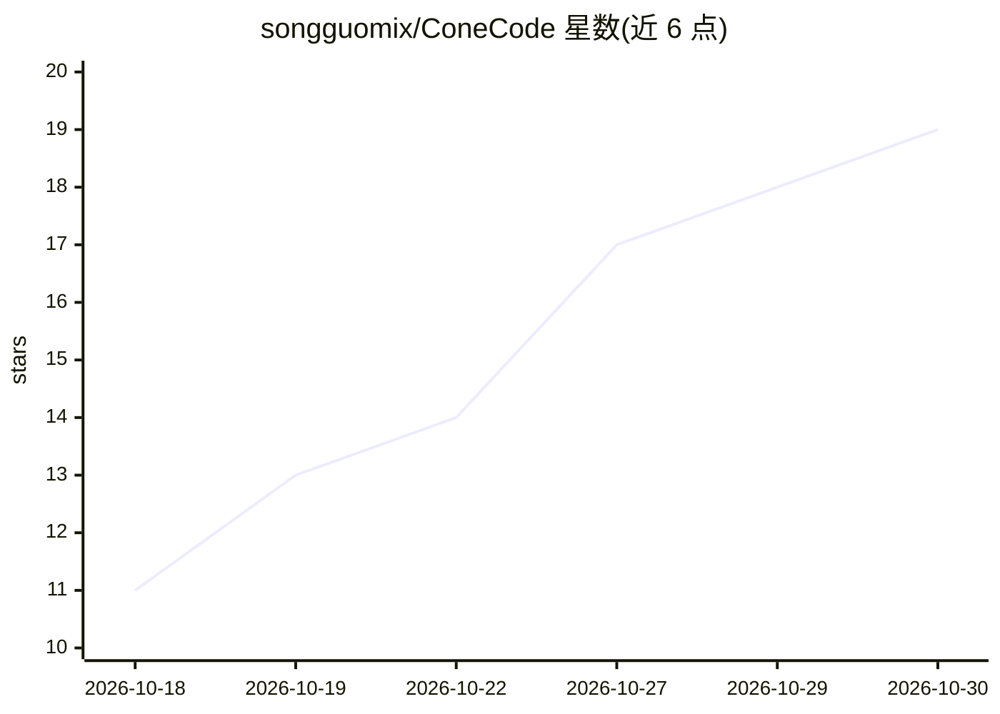

# songguomix/ConeCode

⭐ 19 · TypeScript · MIT · 推送 2026-10-28 · [GitHub](https://github.com/songguomix/ConeCode) · [官网](https://github.com/songguomix/ConeCode/releases/latest) · 个人维护 · 中文 README

**面向 AI 编码代理的桌面工作台，含受限证据驱动的自我改进（RSI）**

基于 Electron、React 和 TypeScript 的桌面应用，为 AI 编码代理提供聊天、文件、编辑器、终端、diff、Git worktree、浏览器预览与模型配置的一体化工作区。提供四种代理模式：Standard、Goal、Orchestrate 与 RSI。RSI 模式在冻结的目标向量与外部验证门（类型检查、测试、指标命令）约束下迭代改进当前项目，限制单集只改一个模块且不能削弱沙箱、审批或测试。模型接入支持 OpenAI、Anthropic、Gemini、DeepSeek、OpenRouter 及自定义 OpenAI 兼容端点，另有无 key 的 ConeCode Free 端点（每周用量上限）。内置图片生成工作室、插件库、技能与记忆面板；macOS 上用 Seatbelt 沙箱限制命令写入范围。从源码运行需 Node.js 22.12+（推荐 24）与 npm。

## 筛选速览

| 维度 | 判定 | 备注 |
|---|---|---|
| AI 角色 | `ai-ecosystem` | LLM/agent 周边工具 |
| 许可风险 | `permissive` | MIT |
| 部署形态 | `desktop` | 安装包/桌面程序 |
| 模型依赖 | locked-api |  |
| 硬件要求 | — | 无带数字的原话,不猜 |
| 安装摩擦 | `low` | 无编译、无系统依赖或容器化 |
| 成熟度 | — | 结构信号不足 |

## 能力要点

- 四种代理模式：Standard、Goal、Orchestrate、RSI
- 受限 RSI：外部目标向量与硬验证门，单集仅改一个已声明模块，带停止条件
- 多提供商模型管理与无 key 的 ConeCode Free 端点
- macOS Seatbelt 命令沙箱与三级审批模式、成本锁（默认 0.5 USD/集）

## 适用场景

- 在一个桌面应用里完成 AI 辅助编码：聊天、编辑、终端、Git 与预览
- 让代理按可度量指标（测试健康、延迟等）迭代改进当前项目
- 通过二维码配对用手机远程访问本机运行的任务

## 场景标签

`编码 Agent` `图像生成` · 领域:编码与开发

## 证据(README 行号)

> L9: ConeCode is an Electron, React, and TypeScript desktop workspace for AI coding agents. It combines chat, files, an e
> L13: - **Four agent modes.** Standard for one-off tasks, Goal for long measurable deliverables, Orchestrate for conducto

## 星数曲线

2026-10-18 11 → 2026-10-30 19（+8）

---
*卡片 v1 · prompt 1.4 · 生成 2026-10-29 · 置信度 high · 依据 README sha `4b2bc91059a7` · [字段定义](../../DATASET.md)*
