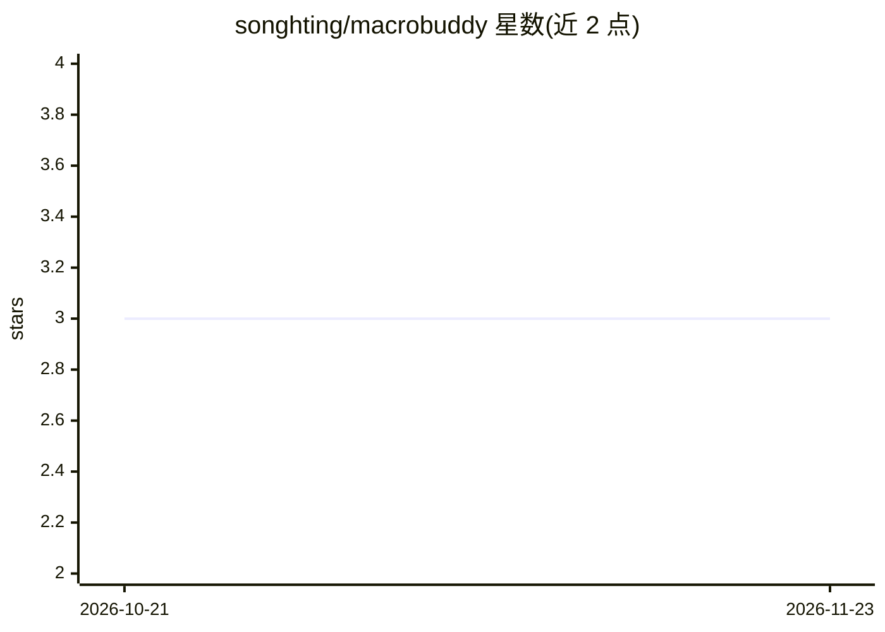

# songhting/macrobuddy

⭐ 3 · Python · MIT · 推送 2026-10-09 · [GitHub](https://github.com/songhting/macrobuddy) · [官网](https://github.com/M-China/mcd-developer-innovation-challenge) · 个人维护 · 中文 README

**给减脂/增肌用户的麦当劳点单决策 MCP Skill**

基于麦当劳 MCP 的点单决策工具，以 WorkBuddy Skill 形式交付：从 MCP 实时读取菜单、营养、优惠券与价格数据，先调用 auto-bind-coupons 领全券再报价，由本地纯函数枚举组合并按热量、蛋白质、脂肪、钠、价格、优惠六维打分，输出综合最优/高蛋白/省钱三套方案及逐条扣分理由。算术全部下沉到本地脚本，LLM 只负责理解请求与解释结果；内置 9 条自测与离线 demo，仅依赖 Python 标准库，下单需用户明确确认。

## 筛选速览

| 维度 | 判定 | 备注 |
|---|---|---|
| AI 角色 | `ai-enhanced` | 去掉 AI 部分产品仍成立 |
| 许可风险 | `permissive` | MIT |
| 部署形态 | `library` | 以包/库形式分发 |
| 模型依赖 | — | README 未给出锁定关系 |
| 硬件要求 | — | 无带数字的原话,不猜 |
| 安装摩擦 | `low` | 无编译、无系统依赖或容器化 |
| 成熟度 | — | 结构信号不足 |

## 能力要点

- MCP 实时取数 + 本地确定性算法，LLM 不参与算术
- 先领全部可领券再报价的优化链路
- 营养字典序优先于优惠力度的排序策略
- 内置自测与离线 demo，无需 Token 可验证

## 适用场景

- 减脂期在麦当劳按热量与蛋白质约束搭一餐
- 在不超脂肪/钠上限的前提下把蛋白质拉满
- 对比多张优惠券叠加后的最优组合
- 本地跑离线 demo 复现点单算法

## 场景标签

 · 领域:生活消费/健康饮食

## 证据(README 行号)

> L4: > 基于麦当劳 MCP 的「**营养 × 预算 × 优惠**」三约束点单决策助手。
> L86: 麦当劳 MCP  ──取真实数据──▶  归一化  ──▶  本地确定性算法  ──▶  方案 + 理由
> L101: 并且每个方案的扣分来源都能逐条打印。LLM 只做两件事：把话听懂、把结果说明白。

## 星数曲线

2026-10-21 3 → 2026-11-23 3（+0）

---
*卡片 v1 · prompt 1.4 · 生成 2026-11-21 · 置信度 low · 依据 README sha `c339863beb8c` · [字段定义](../../DATASET.md)*
