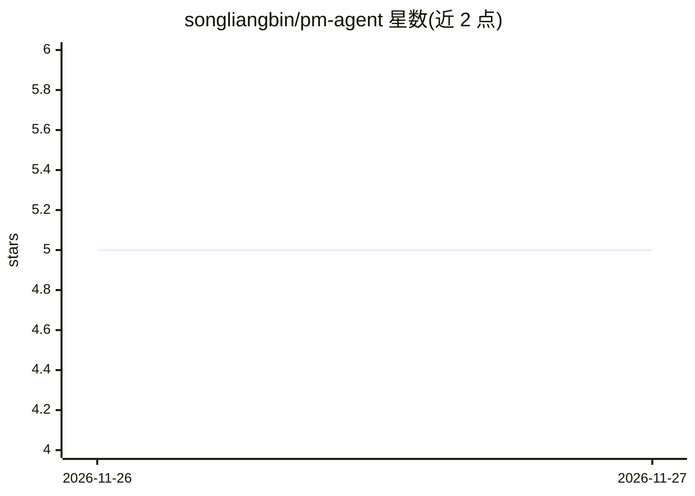

# songliangbin/pm-agent

⭐ 5 · HTML · MIT · 推送 2026-11-24 · [GitHub](https://github.com/songliangbin/pm-agent) · 个人维护 · 中文 README

**产品经理的 Agent 技能包：对话交付 PRD 与可交互原型**

以 Agent Skills 格式分发的技能包，复制到支持该格式的 AI 编程工具 skills 目录即可运行：将用户需求经八步工作流转化为详细版/简易版 PRD、可交互 HTML 原型与自检报告，产出离线可用。内置五层质量门禁（静态 Lint、产品逻辑评审、浏览器机械断言等 120+ 检查项）、197 条踩坑库、14 个行业知识库与 UI 自动走查。要求 Python 3.10+，首次运行自动安装 Playwright/Chromium。产出为示例数据原型，不连接真实数据库或接口。

## 筛选速览

| 维度 | 判定 | 备注 |
|---|---|---|
| AI 角色 | `ai-native` | 本体是模型或模型工具 |
| 许可风险 | `permissive` | MIT |
| 部署形态 | `None` |  |
| 模型依赖 | — | README 未给出锁定关系 |
| 硬件要求 | — | 无带数字的原话,不猜 |
| 安装摩擦 | `low` | 无编译、无系统依赖或容器化 |
| 成熟度 | — | 结构信号不足 |

## 能力要点

- 一次对话产出 PRD×2 + 可交互原型 + 自检报告，全部独立 HTML 可离线演示
- 五层质量门禁与 120+ 脚本确定性检查项
- 197 条踩坑库按端拆分加载，14 个行业知识库内置
- 复制文件夹到 skills 目录即装，适配九种 AI 工具

## 适用场景

- 把口头想法或聊天记录收敛成可上评审会的 PRD
- 在写代码前产出可点击的移动端/桌面端原型演示
- 对生成的原型逐屏截图走查 UI 并留痕修复记录
- 多端项目先立契约再并行生成各端产物

## 场景标签

`AI 写作` · 领域:内容生成

## 证据(README 行号)

> L13: PM Agent 不是代码生成器，而是一位**有流程、有门禁、有记忆**的搭档。
> L104: - 任一支持 Agent Skills 的 AI 编程工具（见下表）
> L105: - Python 3.10+（首次运行会自动检测并安装 Playwright / Chromium）

## 星数曲线

2026-11-26 5 → 2026-11-27 5（+0）

---
*卡片 v1 · prompt 1.4 · 生成 2026-11-26 · 置信度 high · 依据 README sha `a039128c48b3` · [字段定义](../../DATASET.md)*
