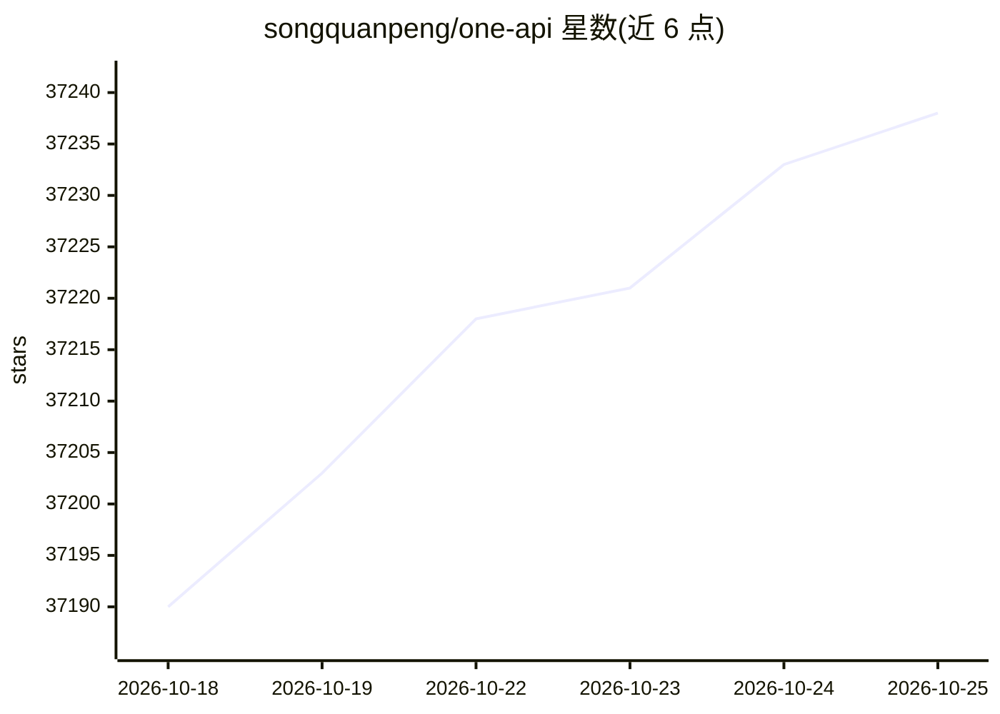

# songquanpeng/one-api

⭐ 37,246 · JavaScript · MIT · 推送 2026-01-09 · [GitHub](https://github.com/songquanpeng/one-api) · [官网](https://oneapi.justsong.cn/) · 个人维护 · 中文 README

**开发者的 LLM API 网关：统一多家模型接口并管理分发 key**

以 Go 编写的 LLM API 管理与分发系统，将数十家模型服务商的接口统一为 OpenAI API 格式对外提供。核心机制包括渠道管理、负载均衡、失败重试、令牌（额度、过期时间、IP 范围、模型范围）与兑换码管理、多机部署主从节点、按分组的倍率计费。默认 SQLite 存储，可通过环境变量切换 MySQL/PostgreSQL 并配置 Redis 缓存。提供单可执行文件、Docker 镜像及宝塔、Sealos、Zeabur、Render 等部署途径。README 提醒需遵循 OpenAI 使用条款及中国区备案要求。

## 筛选速览

| 维度 | 判定 | 备注 |
|---|---|---|
| AI 角色 | `ai-ecosystem` | LLM/agent 周边工具 |
| 许可风险 | `permissive` | MIT |
| 部署形态 | `self-host` | docker 或自建部署 |
| 模型依赖 | local-ok | 支持本地模型 |
| 硬件要求 | — | 无带数字的原话,不猜 |
| 安装摩擦 | `low` | 无编译、无系统依赖或容器化 |
| 成熟度 | — | 结构信号不足 |

## 动量与使用信号

- 维护:`declining` — 距上次 push 282.2 天,年发版 0,130 位贡献者
- 涨星:近 1 天 **+14**(自 20261016 起算)
- 平台:— · 协议:OPENAI-API / OLLAMA

## 能力要点

- 支持 30 余家模型服务商，统一以 OpenAI API 格式访问
- 令牌与兑换码管理：额度、过期时间、IP 范围、模型访问控制
- 多渠道负载均衡与失败自动重试，支持多机主从部署
- 单可执行文件 + Docker 镜像，支持 SQLite/MySQL/PostgreSQL

## 适用场景

- 为团队或应用统一管理多家模型服务商的 API key
- 将 key 二次分发给多个用户并控制额度与权限
- 在多个上游渠道间做负载均衡和失败重试
- 自建 LLM 网关供前端应用（如 ChatGPT Next Web）接入

## 场景标签

`模型网关` · 领域:Agent 开发

## 证据(README 行号)

> L7: _✨ 通过标准的 OpenAI API 格式访问所有的大模型，开箱即用 ✨_
> L57: 1. 支持多种大模型：
> L89: 6. 支持**令牌管理**，设置令牌的过期时间、额度、允许的 IP 范围以及允许的模型访问。

## 星数曲线

2026-10-18 37,190 → 2026-10-25 37,238（+48）

---
*卡片 v1 · prompt 1.4 · 生成 2026-10-18 · 置信度 high · 依据 README sha `af5ec4d38dfd` · [字段定义](../../DATASET.md)*
