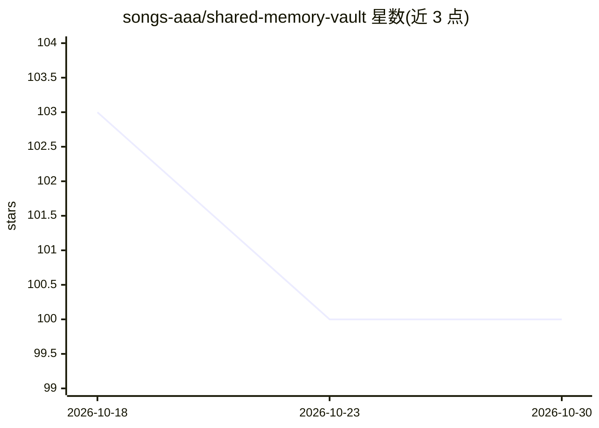

# songs-aaa/shared-memory-vault

⭐ 100 · MIT · 推送 2026-09-05 · [GitHub](https://github.com/songs-aaa/shared-memory-vault) · 个人维护

**多智能体共享记忆治理引擎：云同步 Markdown 知识库**

面向多智能体协作的记忆治理技能：将云同步的纯 Markdown 目录作为共享知识库，通过 CONTEXT.md 会话黑板约定让多个 agent 接续工作，用时间戳加 .bak 处理冲突、增量更新保证单一事实源与跨设备一致性。提供九个治理自动化脚本（归档索引、增量更新、溯源标记、反思、语义检索、跨项目记忆链接、遗忘曲线评分等），全部仅用 Python 标准库，零依赖、无数据库无服务器。附带学术设计依据与五条核心协议规则。

## 筛选速览

| 维度 | 判定 | 备注 |
|---|---|---|
| AI 角色 | `ai-ecosystem` | LLM/agent 周边工具 |
| 许可风险 | `permissive` | MIT |
| 部署形态 | `None` |  |
| 模型依赖 | — | README 未给出锁定关系 |
| 硬件要求 | — | 无带数字的原话,不猜 |
| 安装摩擦 | `low` | 无编译、无系统依赖或容器化 |
| 成熟度 | — | 结构信号不足 |

## 能力要点

- 纯 Markdown 云同步目录作为多 agent 单一事实源，跨设备访问
- 九个治理自动化脚本（归档/增量更新/反思/检索/链接/遗忘曲线等）
- 全部脚本仅用 Python 标准库，零第三方依赖
- 设计映射 Generative Agents/MemGPT/Mem0/A-MEM/MemoryBank 等文献

## 适用场景

- 多个 AI agent 共用一个知识库避免上下文丢失与决策漂移
- 在不同设备上访问同一份 agent 记忆库
- 为 agent 记忆做溯源、衰减评分等治理

## 场景标签

`Agent 记忆` `多智能体` `知识库管理` · 领域:Agent 开发

## 证据(README 行号)

> L13: This skill turns a plain cloud-synced Markdown directory into a **shared knowledge base for every agent and every d
> L17: Multiple AI agents share one knowledge base through a session-blackboard convention (`CONTEXT.md`). Any agent reads
> L25: A **single source of truth**, not per-agent copies. Conflict handling (timestamp + `.bak`) and incremental updates 

## 星数曲线

2026-10-18 103 → 2026-10-30 100（-3）

---
*卡片 v1 · prompt 1.4 · 生成 2026-10-23 · 置信度 high · 依据 README sha `0c49889dbd28` · [字段定义](../../DATASET.md)*
