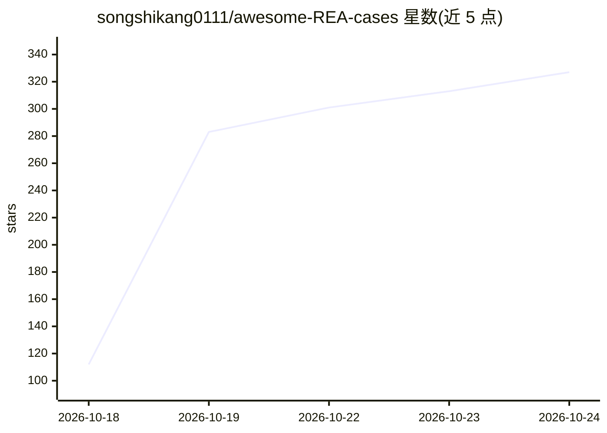

# songshikang0111/awesome-REA-cases

⭐ 327 · Python · MIT · 推送 2026-10-23 · [GitHub](https://github.com/songshikang0111/awesome-REA-cases) · 个人维护 · 中文 README

**AI 辅助逆向工程案例策展清单（669 条，4 大类）**

收集 REA 及其他 AI 辅助逆向工程的项目、实验与想法：涵盖设备复活、应用重建、游戏保存、隐藏行为分析等方向，共 669 条案例，按游戏与保存、硬件与互操作、应用与客户端、算法与功能恢复四类组织。每 4 小时更新（每日 6 次），条目基于作者与项目报告、不独立复现，证据边界逐条记录。明确声明非官方合集，仅收录摘要与公开链接。

## 筛选速览

| 维度 | 判定 | 备注 |
|---|---|---|
| AI 角色 | `ai-knowledge` | 知识聚合/清单类 |
| 许可风险 | `permissive` | MIT |
| 部署形态 | `None` |  |
| 模型依赖 | — | README 未给出锁定关系 |
| 硬件要求 | — | 无带数字的原话,不猜 |
| 安装摩擦 | `low` | 无编译、无系统依赖或容器化 |
| 成熟度 | — | 结构信号不足 |

## 能力要点

- 669 个案例条目，按 4 个类别组织（最多为应用与客户端 297 条）
- 每日 6 次自动更新，记录每条的证据边界与项目状态
- 仅收录公开实现与摘要，不涉及专有软件与私钥
- 原策展内容与代码以 MIT 许可发布

## 适用场景

- 查找 AI 辅助逆向工程的已有案例与公开实现
- 了解 REA 在设备互操作、游戏保存等方向的实践范围
- 按类别浏览可参考的逆向工程项目

## 场景标签

`精选清单` · 领域:学习与行业

## 证据(README 行号)

> L9: A curated collection of **reverse-engineering projects, experiments, and ideas**: revive old devices, rebuild apps, 
> L17: Covers REA and other AI-assisted work. REA connects coding agents to local reverse-engineering tools through CLI an
> L19: *Based on author and project reports; not independently reproduced here. Evidence and project status are recorded i

## 星数曲线

2026-10-18 112 → 2026-10-24 327（+215）

---
*卡片 v1 · prompt 1.4 · 生成 2026-10-21 · 置信度 high · 依据 README sha `953f7cdb22cd` · [字段定义](../../DATASET.md)*
