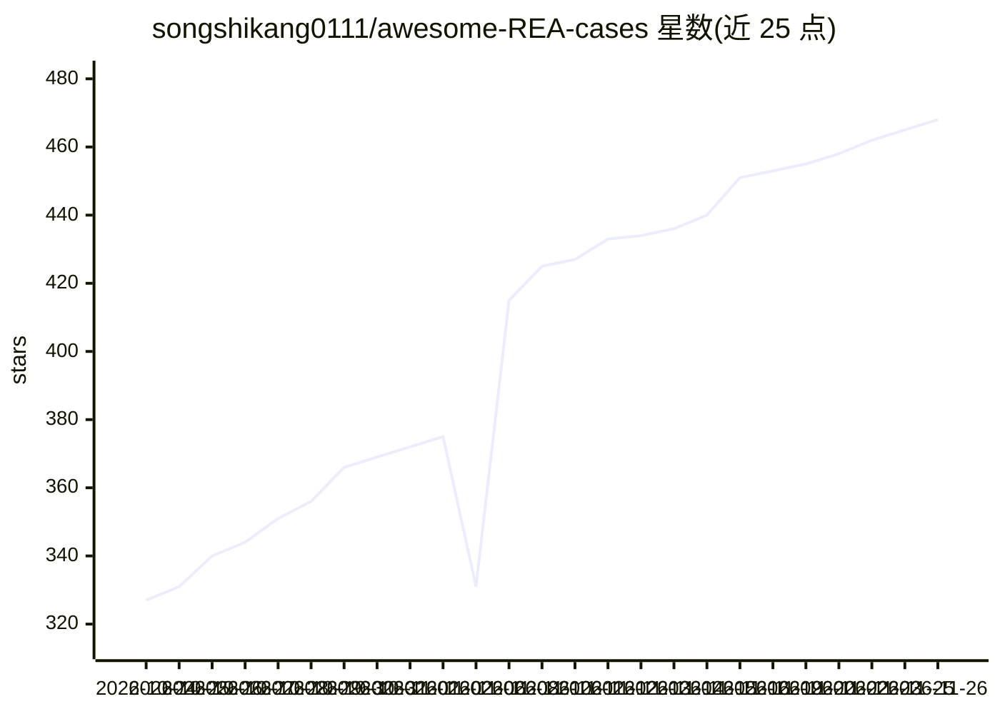

# songshikang0111/awesome-REA-cases

⭐ 468 · Python · MIT · 推送 2026-11-25 · [GitHub](https://github.com/songshikang0111/awesome-REA-cases) · 个人维护 · 中文 README

**AI 辅助逆向工程案例与项目的策展清单**

按 MIT 许可维护的非官方案例合集，收录 2729 个 AI 辅助逆向工程（REA）相关案例、项目与想法，覆盖游戏保存、硬件互操作、应用重建与算法恢复四个类别；条目含来源日期、证据边界与状态标注，并明确记录未复现的声明与失败尝试。REA 通过 CLI 和 MCP 将编码 agent 连接到本地逆向工程工具。清单每日更新六次，提供中英文切换与分类浏览。

## 筛选速览

| 维度 | 判定 | 备注 |
|---|---|---|
| AI 角色 | `ai-knowledge` | 知识聚合/清单类 |
| 许可风险 | `permissive` | MIT |
| 部署形态 | `desktop` | 安装包/桌面程序 |
| 模型依赖 | — | README 未给出锁定关系 |
| 硬件要求 | — | 无带数字的原话,不猜 |
| 安装摩擦 | `low` | 无编译、无系统依赖或容器化 |
| 成熟度 | — | 结构信号不足 |

## 能力要点

- 2729 个案例与项目，按四大类别组织
- 每日 6 次自动搜索更新，记录来源日期与证据边界
- 明确标注未独立复现的声明（Unverified here / In progress）
- 收录失败尝试与作者更正

## 适用场景

- 查找 AI 辅助逆向工程的已验证案例与工具链
- 研究游戏保存与旧软件重建的项目做法
- 了解硬件互操作（驱动、蓝牙外设）的 AI 辅助研究路径

## 场景标签

`精选清单` · 领域:学习与行业

## 证据(README 行号)

> L9: A curated collection of **AI-assisted reverse-engineering projects, experiments, and ideas** for device interoperabi
> L11: # 2729 cases & projects
> L17: Covers REA and other AI-assisted work. REA connects coding agents to local reverse-engineering tools through CLI an

## 星数曲线

2026-10-24 327 → 2026-11-26 468（+141）

---
*卡片 v1 · prompt 1.4 · 生成 2026-11-25 · 置信度 high · 依据 README sha `885d276fb912` · [字段定义](../../DATASET.md)*
