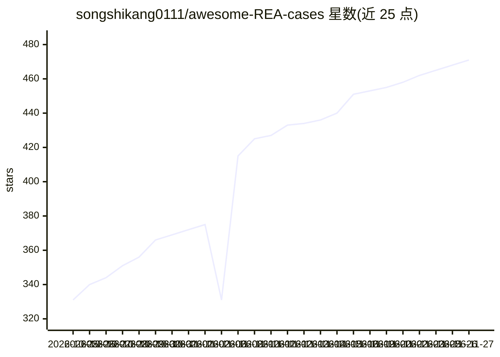

# songshikang0111/awesome-REA-cases

⭐ 471 · Python · MIT · 推送 2026-11-26 · [GitHub](https://github.com/songshikang0111/awesome-REA-cases) · 个人维护 · 中文 README

**AI 辅助逆向工程案例清单：收录近 3000 个项目与实验**

策展型清单，收录 AI 辅助逆向工程（REA）的项目、实验与想法，覆盖设备互操作、行为保持的应用重建与游戏保存，也包含失败尝试与作者更正。共 2887 条，按游戏与保存、硬件与互操作、应用与客户端、算法与特征恢复四类组织，每日更新 6 次。条目附来源日期与证据状态标注，多个案例注明未在本仓库独立复现，仅基于作者报告。以链接与摘要形式提供，不含专有软件或素材。

## 筛选速览

| 维度 | 判定 | 备注 |
|---|---|---|
| AI 角色 | `ai-knowledge` | 知识聚合/清单类 |
| 许可风险 | `permissive` | MIT |
| 部署形态 | `desktop` | 安装包/桌面程序 |
| 模型依赖 | — | README 未给出锁定关系 |
| 硬件要求 | — | 无带数字的原话,不猜 |
| 安装摩擦 | `low` | 无编译、无系统依赖或容器化 |
| 成熟度 | — | 结构信号不足 |

## 能力要点

- 2887 条案例，每日更新 6 次
- 按 4 个类别组织（游戏保存 564、硬件互操作 760、应用 1194、算法恢复 369）
- 每条附来源日期、证据边界与'未在此验证'等状态标注
- REA 通过 CLI 和 MCP 将编码 agent 连接到本地逆向工程工具

## 适用场景

- 查找 AI 辅助逆向工程的参考案例和方法
- 研究旧编译器、DOS 游戏等二进制的重建思路
- 了解设备驱动与硬件互操作的 AI 辅助实践

## 场景标签

`精选清单` · 领域:学习与行业

## 证据(README 行号)

> L9: A curated collection of **AI-assisted reverse-engineering projects, experiments, and ideas** for device interoperabi
> L11: # 2887 cases & projects
> L53: |Games & preservation|**564**|

## 星数曲线

2026-10-25 331 → 2026-11-27 471（+140）

---
*卡片 v1 · prompt 1.4 · 生成 2026-11-27 · 置信度 high · 依据 README sha `cf7186922707` · [字段定义](../../DATASET.md)*
