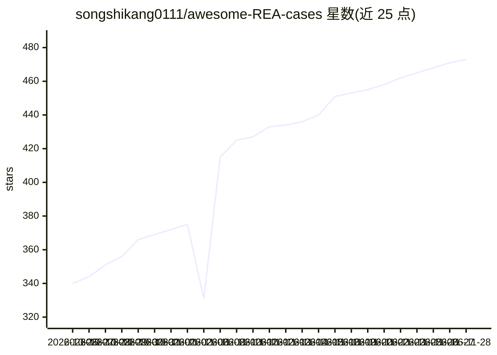

# songshikang0111/awesome-REA-cases

⭐ 473 · Python · MIT · 推送 2026-11-27 · [GitHub](https://github.com/songshikang0111/awesome-REA-cases) · 个人维护 · 中文 README

**AI 辅助逆向工程案例聚合清单（2924 条）**

面向软件/硬件逆向研究者的策展清单，收录 AI 辅助逆向工程项目、实验与思路共 2924 条，覆盖设备互操作、行为保持式应用重建与游戏保存，包含失败案例与作者更正。条目按游戏保存、硬件互操作、应用客户端、算法恢复四类组织，每日更新六次；内容基于作者与项目报告，未独立复现，证据边界逐条记录于案例页。声明为非官方集合，原始整理部分 MIT 许可。

## 筛选速览

| 维度 | 判定 | 备注 |
|---|---|---|
| AI 角色 | `ai-knowledge` | 知识聚合/清单类 |
| 许可风险 | `permissive` | MIT |
| 部署形态 | `desktop` | 安装包/桌面程序 |
| 模型依赖 | — | README 未给出锁定关系 |
| 硬件要求 | — | 无带数字的原话,不猜 |
| 安装摩擦 | `low` | 无编译、无系统依赖或容器化 |
| 成熟度 | — | 结构信号不足 |

## 能力要点

- 2924 条案例按四大类别组织，含失败尝试与作者更正
- 每 4 小时自动更新，关键词与分页搜索每日运行六次
- 每条案例记录来源日期、证据边界与未复现标注
- REA 通过 CLI 和 MCP 连接编码 agent 与本地逆向工具

## 适用场景

- 为游戏保存项目查找 AI 辅助反编译/重建案例
- 调研 Linux 驱动或设备互操作的 AI 辅助研究路径
- 参考字节级匹配重建老编译器与 DOS 程序的做法
- 了解 AI 编码 agent 在安全审计中的应用案例

## 场景标签

`精选清单` · 领域:学习与行业

## 证据(README 行号)

> L3: # Awesome REA Cases
> L9: A curated collection of **AI-assisted reverse-engineering projects, experiments, and ideas** for device interoperabi
> L68: **Unofficial collection.** Original summaries and public links only; no proprietary software, game assets, keys, or

## 星数曲线

2026-10-26 340 → 2026-11-28 473（+133）

---
*卡片 v1 · prompt 1.4 · 生成 2026-11-28 · 置信度 high · 依据 README sha `9b7bdfe8061c` · [字段定义](../../DATASET.md)*
