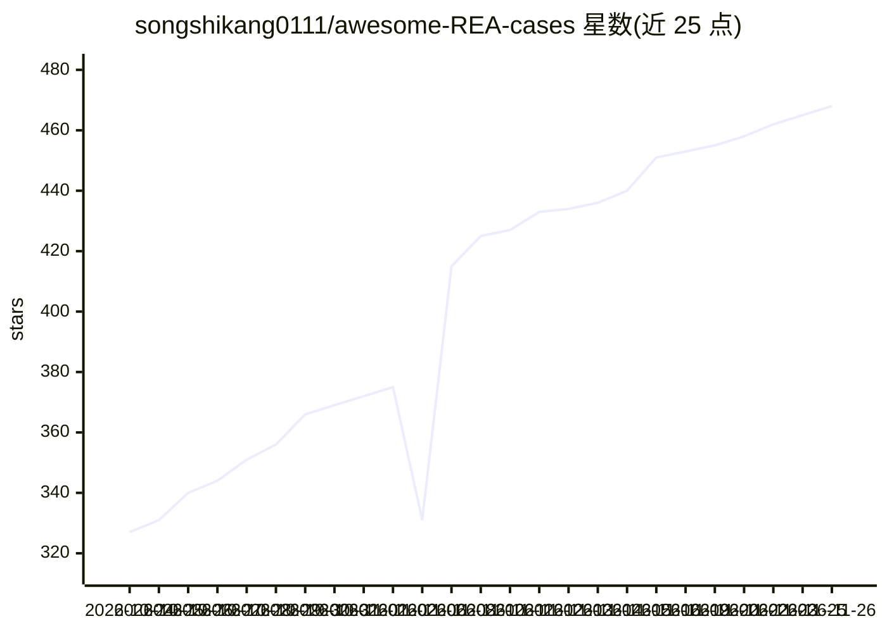

# songshikang0111/awesome-REA-cases

⭐ 468 · Python · MIT · 推送 2026-11-25 · [GitHub](https://github.com/songshikang0111/awesome-REA-cases) · 个人维护 · 中文 README

**AI 辅助逆向工程案例与项目策展清单（2830 条）**

按 awesome-list 形式维护的案例索引，收录 AI 辅助逆向工程（REA）相关的项目、实验与想法，覆盖设备互操作、行为保持的应用重建与游戏保存，包含失败尝试与作者更正。通过每日 6 次的关键词与分页搜索更新，条目按游戏保存、硬件互操作、应用与客户端、算法恢复四类组织，每个案例记录来源、证据边界与验证状态；收录内容为原创摘要与公开链接，不含专有软件或私有素材。

## 筛选速览

| 维度 | 判定 | 备注 |
|---|---|---|
| AI 角色 | `ai-knowledge` | 知识聚合/清单类 |
| 许可风险 | `permissive` | MIT |
| 部署形态 | `desktop` | 安装包/桌面程序 |
| 模型依赖 | — | README 未给出锁定关系 |
| 硬件要求 | — | 无带数字的原话,不猜 |
| 安装摩擦 | `low` | 无编译、无系统依赖或容器化 |
| 成熟度 | — | 结构信号不足 |

## 能力要点

- 收录 2830 条案例与项目，每日更新 6 次
- 按 Games/Hardware/Applications/Algorithms 四类组织条目
- 每个案例记录证据边界与验证状态（未复现/进行中等标注）
- 包含失败尝试与作者更正

## 适用场景

- 查找 AI 辅助逆向工程的参考案例与方法记录
- 调研游戏保存或二进制重建类项目的现状
- 了解硬件互操作研究中 AI 工具的使用方式

## 场景标签

`精选清单` `网络安全` · 领域:学习与行业

## 证据(README 行号)

> L3: # Awesome REA Cases
> L9: A curated collection of **AI-assisted reverse-engineering projects, experiments, and ideas** for device interoperabi
> L51: |Category|Entries|

## 星数曲线

2026-10-24 327 → 2026-11-26 468（+141）

---
*卡片 v1 · prompt 1.4 · 生成 2026-11-26 · 置信度 high · 依据 README sha `18a699fb29b8` · [字段定义](../../DATASET.md)*
