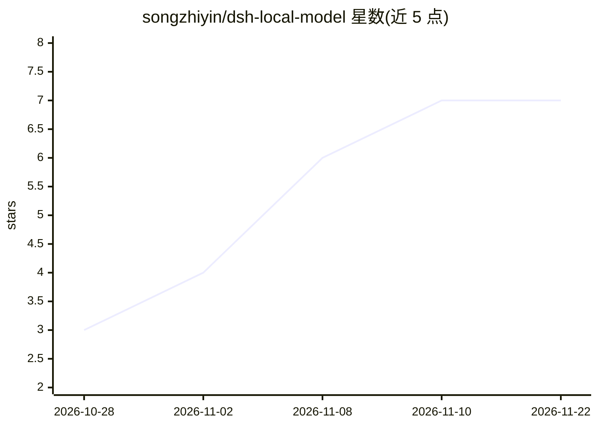

# songzhiyin/dsh-local-model

⭐ 7 · JavaScript · MIT · 推送 2026-10-14 · [GitHub](https://github.com/songzhiyin/dsh-local-model) · [官网](https://github.com/songzhiyin/dsh-local-model) · 个人维护 · 中文 README

**让 DeepSeek Harness 接入本地模型的插件**

一个 DeepSeek Harness 插件，注册自定义 LLM 适配器（provider 路由 `local`），把 Harness 的模型请求转发到本机推理服务：支持 OpenAI 兼容协议与 Ollama 原生 API 两种传输，自动拉取本地模型列表，转换工具调用历史并提供纯文本工具调用的识别兜底。配置含上下文窗口、温度等字段，浏览器端 UI 提供连接测试；不访问 api.deepseek.com、不消耗账号 token。安装方式包括 dsh 命令行、Harness 插件市场与 GitHub 克隆。

## 筛选速览

| 维度 | 判定 | 备注 |
|---|---|---|
| AI 角色 | `ai-ecosystem` | LLM/agent 周边工具 |
| 许可风险 | `permissive` | MIT |
| 部署形态 | `library` | 以包/库形式分发 |
| 模型依赖 | local-ok | 支持本地模型 |
| 硬件要求 | — | 无带数字的原话,不猜 |
| 安装摩擦 | `low` | 无编译、无系统依赖或容器化 |
| 成熟度 | — | 结构信号不足 |

## 能力要点

- 注册 `local` 适配器，支持 OpenAI 兼容 /v1 与 Ollama 原生 /api/chat 双传输
- 自动发现本地模型（/models、/api/tags）并支持热更新配置
- 工具调用历史转换与纯文本 JSON 工具调用的兜底识别
- 浏览器端 UI 卡片提供连接测试与图形化配置

## 适用场景

- 在 DeepSeek Harness 里使用本机 Ollama/LM Studio/llama.cpp 模型对话
- 不登录账号、不消耗云端 token 地运行 Agent 工具调用
- 本地模型把工具调用写成文本时让其转为真正的工具调用

## 场景标签

`模型网关` · 领域:Agent 开发

## 证据(README 行号)

> L10: > A DeepSeek Harness plugin that connects the
> L18: DeepSeek Harness 默认走 DeepSeek 云端模型。本插件注册一个自定义 LLM 适配器（provider 路由 `local`），
> L177: 插件通过 `ctx.llm.registerAdapter(["local"], adapter)` 注册一个 `LlmAdapter`，把 Harness 的

## 星数曲线

2026-10-28 3 → 2026-11-22 7（+4）

---
*卡片 v1 · prompt 1.4 · 生成 2026-11-20 · 置信度 mid · 依据 README sha `fba105020a26` · [字段定义](../../DATASET.md)*
