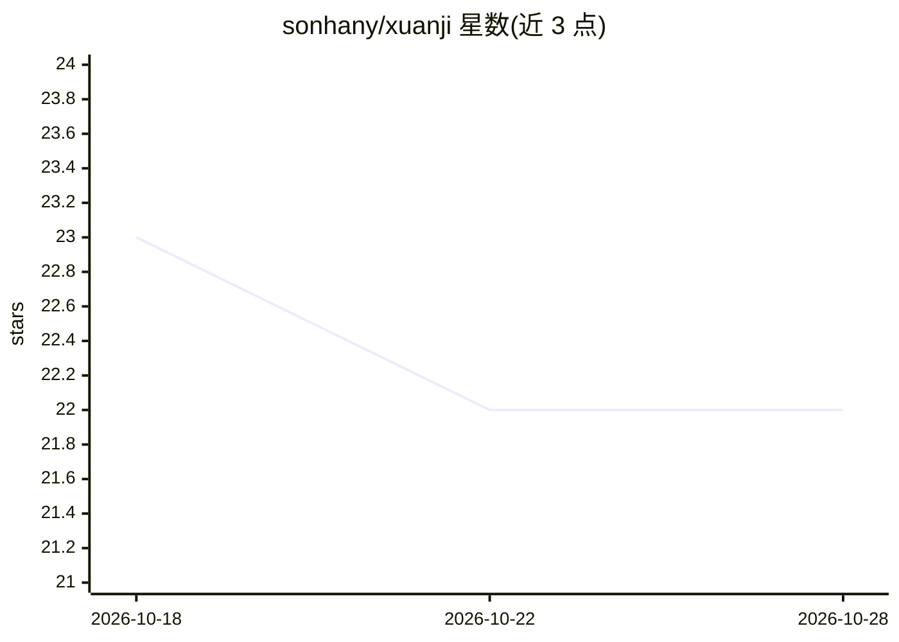

# sonhany/xuanji

⭐ 22 · Python · 推送 2026-09-19 · [GitHub](https://github.com/sonhany/xuanji) · 个人维护 · 中文 README

**面向 A 股的本机量化研究与确定性模拟盘工作台**

单机 Windows 运行的量化研究工作台，覆盖数据接入（TdxQuant/AkShare/BaoStock 等）、58 因子研究、F4 多 Alpha 候选工厂、Qlib 六年 PIT 训练与双引擎回测、F5 确定性模拟执行（独立账本、十项对账）与硬风控审计。明确不连实盘：live_execution_authority=false，任意下单返回 HTTP 409。AI Agent 自治控制面已于 2026-08-13 退役，仅保留零执行权限的只读 AI 影子研究（DecisionProposal 合同）。React+TypeScript 前端 + Node API + Python 量化核心，便携包需联网装依赖。

## 筛选速览

| 维度 | 判定 | 备注 |
|---|---|---|
| AI 角色 | `ai-enhanced` | 去掉 AI 部分产品仍成立 |
| 许可风险 | `none` | — |
| 部署形态 | `library` | 以包/库形式分发 |
| 模型依赖 | — | README 未给出锁定关系 |
| 硬件要求 | — | 无带数字的原话,不猜 |
| 安装摩擦 | `low` | 无编译、无系统依赖或容器化 |
| 成熟度 | — | 结构信号不足 |

## 能力要点

- 数据→因子→Qlib 训练→回测→F5 模拟执行→风控的完整链路
- F5 确定性模拟账本：十项对账、T+1、涨跌停、幂等重放
- 硬风控与研究/执行分离：promotion_state=research_only，下单一律 HTTP 409
- AI 部分仅剩只读影子研究，四个执行/策略权限布尔值全为 false

## 适用场景

- 在本地做 A 股因子挖掘与策略回测验证
- 用 Qlib 做窗口隔离训练并双引擎回测
- 运行确定性模拟盘并逐单审计风控规则

## 场景标签

`金融量化` · 领域:学习与行业

## 证据(README 行号)

> L15: |AI 自治|控制面已于 **2026-08-13 退役**；仅保留**只读** AI 影子研究（`DecisionProposal` 合同，零执行权限）|
> L27: 6. **只读 AI 影子研究** —— 受控上下文 + `DecisionProposal` 合同，输出固定 `shadow_only`，四个执行/策略权限布尔值全为 `false`。
> L134: - AI Agent 自治控制面（`quant/ai`、`scripts/ai_*`、`scripts/paper/*`、`ai_manifest.json`、`ai_tools.json`）。

## 星数曲线

2026-10-18 23 → 2026-10-28 22（-1）

---
*卡片 v1 · prompt 1.4 · 生成 2026-10-27 · 置信度 high · 依据 README sha `a3646451ac8a` · [字段定义](../../DATASET.md)*
