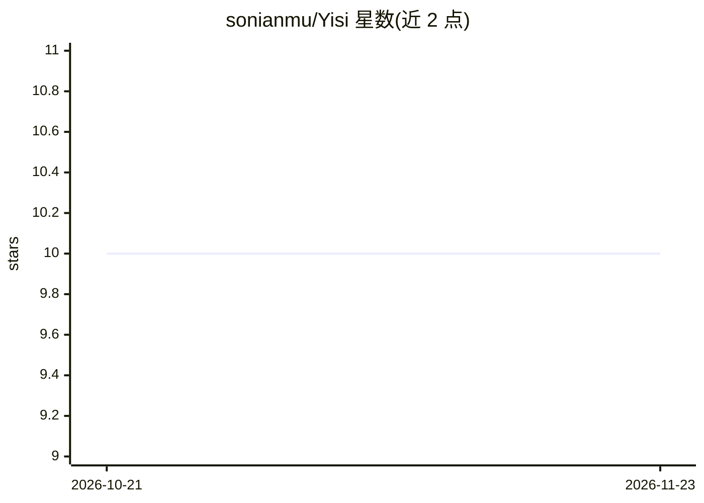

# sonianmu/Yisi

⭐ 10 · Swift · GPL-3.0 · 推送 2026-11-06 · [GitHub](https://github.com/sonianmu/Yisi) · [官网](https://yisi.pages.dev/) · 个人维护 · 中文 README

**macOS 选中即转换的 AI 语义转换工具**

面向 macOS 的语义转换工具：选中文本或截图后按快捷键，就地弹出转换结果，无聊天窗口。核心是翻译，可扩展为摘要、改写等形式；带学习规则记忆用户术语偏好、预设模式、离线系统翻译、截图视觉识别、本地历史与菜单栏常驻。AI 服务内置 Gemini/OpenAI/智谱/DeepSeek/MiniMax 模板及自定义 OpenAI 兼容端点，模型 ID 由用户填写；支持模块系统扩展。分发 DMG，亦提供可检视的辅助安装包；需辅助功能与屏幕录制权限。

## 筛选速览

| 维度 | 判定 | 备注 |
|---|---|---|
| AI 角色 | `ai-native` | 本体是模型或模型工具 |
| 许可风险 | `viral` | GPL-3.0 |
| 部署形态 | `desktop` | 安装包/桌面程序 |
| 模型依赖 | — | README 未给出锁定关系 |
| 硬件要求 | — | 无带数字的原话,不猜 |
| 安装摩擦 | `low` | 无编译、无系统依赖或容器化 |
| 成熟度 | — | 结构信号不足 |

## 能力要点

- 选中文本按 Cmd+C+C 就地出结果，无聊天窗口设计
- 内置 5 家 AI 服务模板 + 自定义 OpenAI 兼容/Gemini/Anthropic 端点
- 学习规则：纠正一次术语后自动应用于后续翻译
- macOS 原生系统翻译实现完全离线本地转换

## 适用场景

- 阅读外文资料时选中即翻，不打断当前工作流
- 截取设计稿或报错弹窗交给 AI 分析
- 把选中文本按预设规则转换成摘要、改写等形式

## 场景标签

`AI 写作` · 领域:内容生成

## 证据(README 行号)

> L3:  Intelligent semantic conversion tool for macOS -- Select, trigger, present. No chat windows, no context switching. 
> L16: - **Instant Translation** -- Select text, press a shortcut, and the translation appears in place. Built-in finely-t
> L22: - **Configurable AI Services** -- Built-in Gemini, OpenAI, Zhipu AI, DeepSeek, and MiniMax connection templates, pl

## 星数曲线

2026-10-21 10 → 2026-11-23 10（+0）

---
*卡片 v1 · prompt 1.4 · 生成 2026-11-19 · 置信度 high · 依据 README sha `f4dc9c59d96c` · [字段定义](../../DATASET.md)*
