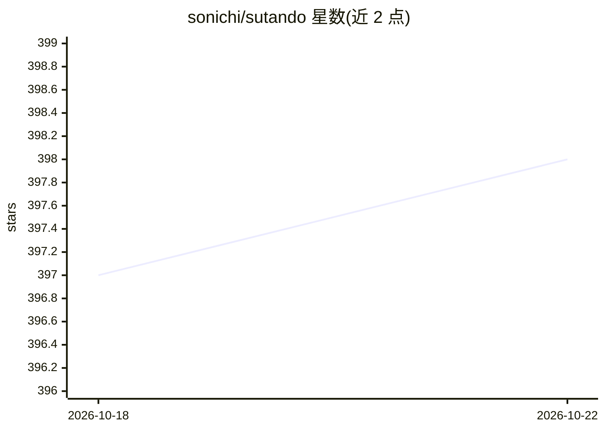

# sonichi/sutando

⭐ 398 · Python · MIT · 推送 2026-10-21 · [GitHub](https://github.com/sonichi/sutando) · [官网](https://sutando.ai) · 个人维护

**自托管的个人 AI 代理：语音/电话/会议替你干活并自我改进**

运行在用户 Mac 上的个人 AI 代理应用：通过语音、屏幕捕获、电话（Twilio）、Zoom/Google Meet、Telegram、Discord 等渠道接收指令，由 Claude Code 或 Codex CLI 会话作为核心代理执行任务（改文档、代打电话、参会做纪要、记笔记）。空闲时运行自主构建循环，监控自身健康并生成新功能代码。四个进程协作：Gemini Live 语音代理、通话服务器、Web 客户端与核心代理。声明为 Alpha 阶段，仅支持 macOS，核心以无头模式从源码启动，菜单栏应用需本地构建。

## 筛选速览

| 维度 | 判定 | 备注 |
|---|---|---|
| AI 角色 | `ai-native` | 本体是模型或模型工具 |
| 许可风险 | `permissive` | MIT |
| 部署形态 | `desktop` | 安装包/桌面程序 |
| 模型依赖 | — | README 未给出锁定关系 |
| 硬件要求 | — | 无带数字的原话,不猜 |
| 安装摩擦 | `medium` | 含编译或系统依赖之一 |
| 成熟度 | `idea` | |

## 能力要点

- 多渠道接入：语音、电话、会议、Telegram、Discord、Web 共享同一代理与记忆
- 核心代理通过 Claude Code 或 Codex CLI 会话执行，无需按 token 计费的核心 API key
- 空闲时自主构建循环：健康检查、模式学习、生成缺失能力代码
- 3 级访问门控与 git-rules-guard 钩子对公开写操作弹出审批

## 适用场景

- 用语音指挥代理改文档、接会议、代打电话并汇报
- 外出时通过电话/Telegram 远程查看与操作自己的 Mac
- 让代理在空闲时自动维护并扩展自身功能

## 场景标签

 · 领域:个人 AI 代理/自动化

## 证据(README 行号)

> L8: Voice, vision, screen, meetings, calls when I'm engaged. Learns my patterns, ships its own code when I'm not. Runs a
> L41: **Talk while you work.** You're looking at a doc. You say "make this paragraph shorter." Sutando sees your screen, 
> L82: - **Core agent** (Claude Code or Codex CLI) — executes tasks with full system access. The persistent CLI session pr

## 星数曲线

2026-10-18 397 → 2026-10-22 398（+1）

---
*卡片 v1 · prompt 1.4 · 生成 2026-10-21 · 置信度 mid · 依据 README sha `510117f7759f` · [字段定义](../../DATASET.md)*
