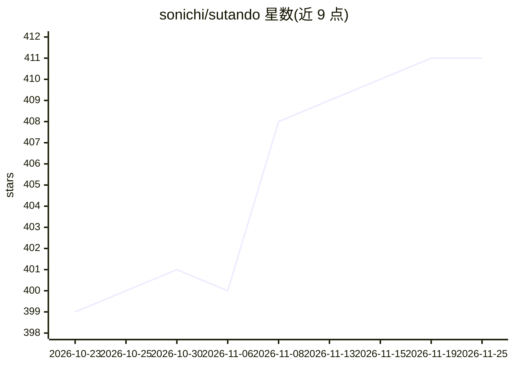

# sonichi/sutando

⭐ 411 · Python · MIT · 推送 2026-11-24 · [GitHub](https://github.com/sonichi/sutando) · [官网](https://sutando.ai) · 个人维护

**macOS 上的个人 AI 代理：语音/屏幕/电话协作与自主改进**

运行在用户自己 Mac 上的开源个人 AI 代理：白天通过语音、屏幕视觉、会议接入（Zoom/Google Meet）、电话拨打等方式实时协助工作，空闲时运行自主构建循环，检测使用模式、发现技能并生成缺失能力。核心代理复用用户已登录的 Claude Code 或 Codex CLI 会话执行任务，语音与电话通道基于 Gemini Live，多通道经 tasks/ 目录与内联工具分流。要求 macOS、Node.js、Python 3 等前置条件，项目自述处于 Alpha 阶段。

## 筛选速览

| 维度 | 判定 | 备注 |
|---|---|---|
| AI 角色 | `ai-native` | 本体是模型或模型工具 |
| 许可风险 | `permissive` | MIT |
| 部署形态 | `desktop` | 安装包/桌面程序 |
| 模型依赖 | locked-api |  |
| 硬件要求 | — | 无带数字的原话,不猜 |
| 安装摩擦 | `medium` | 含编译或系统依赖之一 |
| 成熟度 | `idea` | |

## 能力要点

- 复用 Claude Code 或 Codex CLI 会话作为核心代理，无需按 token 付费的独立 API key
- 语音代理与电话会话服务基于 Gemini Live（WebSocket :9900/:3100）
- 自主构建循环：cron 每 15/30 分钟执行 /proactive-loop，监控 tasks/ 目录
- 支持多 Mac 间代理自行协调迁移服务，语音/Telegram/Discord/电话/邮件多通道接入

## 适用场景

- 工作时用语音让代理改写文档、截图识别内容
- 让代理代替自己参加会议并生成总结
- 通过电话或 Telegram 远程指挥 Mac 上的代理执行任务
- 让代理在空闲时段自主学习技能并完善自身代码

## 场景标签

`语音 Agent` `AI 助手` · 领域:对话与助手

## 证据(README 行号)

> L8: Voice, vision, screen, meetings, calls when I'm engaged. Learns my patterns, ships its own code when I'm not. Runs a
> L91: - **Voice agent** (Gemini Live, WebSocket on :9900) — listens and talks in real time for browser voice.
> L94: - **Core agent** (Claude Code or Codex CLI) — executes tasks with full system access. The persistent CLI session pr

## 星数曲线

2026-10-23 399 → 2026-11-25 411（+12）

---
*卡片 v1 · prompt 1.4 · 生成 2026-11-25 · 置信度 mid · 依据 README sha `d64502ff442e` · [字段定义](../../DATASET.md)*
