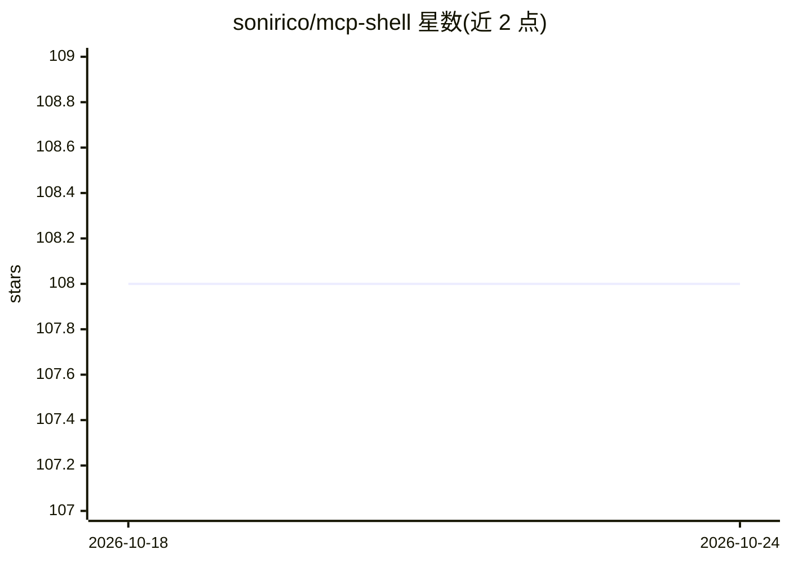

# sonirico/mcp-shell

⭐ 108 · Go · GPL-3.0 · 推送 2026-09-25 · [GitHub](https://github.com/sonirico/mcp-shell) · [官网](https://sonirico.dev/posts/the-allowlist-that-runs-anything/) · 个人维护

**MCP 服务器：让 LLM 以受控、可审计方式运行 shell 与文件/git 操作**

基于 mark3labs/mcp-go 的 Go 实现 Model Context Protocol 服务器，为 LLM 提供类型化 shell 能力工具。默认安全模式只注册类型化工具（文件读取、grep/glob、git 检查、可选的写入与脚本执行），路径限制在 working_directory 内，不提供原生 shell 命令；通过 MCP_SHELL_ALLOW_UNSAFE=1 可显式切换到无限制 shell_exec。安全机制包括服务端自建 argv、git 加固、子进程最小环境变量、非 root Docker 镜像。面向需要在 Claude Desktop 等 MCP 客户端中接入本地命令执行能力的开发者。

## 筛选速览

| 维度 | 判定 | 备注 |
|---|---|---|
| AI 角色 | `ai-ecosystem` | LLM/agent 周边工具 |
| 许可风险 | `viral` | GPL-3.0 |
| 部署形态 | `self-host` | docker 或自建部署 |
| 模型依赖 | — | README 未给出锁定关系 |
| 硬件要求 | — | 无带数字的原话,不猜 |
| 安装摩擦 | `low` | 无编译、无系统依赖或容器化 |
| 成熟度 | — | 结构信号不足 |

## 能力要点

- 默认安全模式仅注册类型化工具，路径限定在 working_directory
- MCP_SHELL_ALLOW_UNSAFE=1 显式开启无验证的 shell_exec
- git 加固：--end-of-options、拒绝以 - 开头的 ref、禁用 hooks/pager
- 子进程仅继承 PATH/HOME/LANG，不暴露服务器环境变量

## 适用场景

- 为 Claude Desktop 等 MCP 客户端添加本地文件与 git 操作工具
- 让 AI agent 在受控目录内执行可审计的命令
- 需要原生 shell 时以显式环境变量切换无限制模式

## 场景标签

`Agent 框架` · 领域:Agent 开发

## 证据(README 行号)

> L6: MCP server that runs shell commands. Your LLM gets a tool; you get control over what runs and how.
> L8: Built on mark3labs/mcp-go. Written in Go.

## 星数曲线

2026-10-18 108 → 2026-10-24 108（+0）

---
*卡片 v1 · prompt 1.4 · 生成 2026-10-23 · 置信度 high · 依据 README sha `b054d4e08d28` · [字段定义](../../DATASET.md)*
