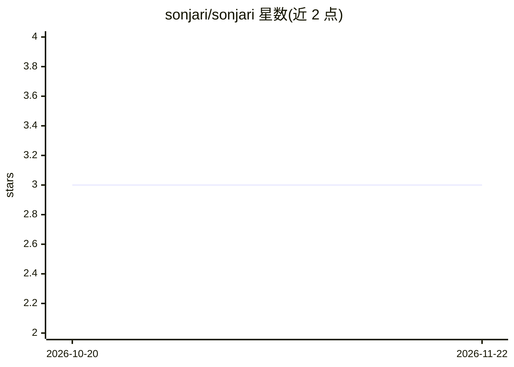

# sonjari/sonjari

⭐ — · [GitHub]() · 个人维护

**Windows 本地 GPU 上运行的 AI 代理：浏览器研究与文档产出**

面向 Windows 用户的开源本地 AI 代理：在用户 GPU 上通过 Ollama 运行本地模型，操作用户已登录的 Chrome 完成网页浏览、数据读取并生成 Excel/Word 文件等任务。每个任务留下步骤、来源与结果出处，未获工具返回的数字会被标记，发送/支付等不可逆操作需用户审批。可作为 MCP 服务器接入 Claude Code、Codex、Cursor 等宿主，承接繁重阅读任务并只返回结果与凭据；也支持通过 Discord 从手机下发任务。限制：仅支持 Windows 与 NVIDIA GPU，速度慢于云端 AI。

## 筛选速览

| 维度 | 判定 | 备注 |
|---|---|---|
| AI 角色 | `ai-native` | 本体是模型或模型工具 |
| 许可风险 | `permissive` | — |
| 部署形态 | `desktop` | 安装包/桌面程序 |
| 模型依赖 | local-ok | 支持本地模型 |
| 硬件要求 | — | 无带数字的原话,不猜 |
| 安装摩擦 | `low` | 无编译、无系统依赖或容器化 |
| 成熟度 | — | 结构信号不足 |

## 能力要点

- 在用户已登录的 Chrome 中执行浏览任务，遇到登录/CAPTCHA/支付停下交还用户
- MCP 接口（sonjari_task）供 Claude Code/Codex/Cursor 委托本地阅读任务
- 首次启动向导测量硬件并自动选择、下载适配的本地模型（4B/9B/27B）
- 结果溯源：保留读取页面出处，标记无依据数字，不可逆操作需审批

## 适用场景

- 让本地代理自动整理网页信息并输出 Excel 表格
- 把繁重的多页阅读任务从 Claude Code 委托给本地 GPU 执行
- 通过家里电脑的 Discord 机器人远程下达任务并收取结果
- 长时间编码会话后恢复被压缩丢失的决策上下文

## 场景标签

`浏览器自动化` `AI 助手` · 领域:效率与自动化

## 证据(README 行号)

> L3:  An AI coworker that works in your own browser.
> L30: One sentence in, an Excel file out. Sonjari opens GitHub Trending, reads the top three Python repositories and save
> L51: Claude Code hands the research to Sonjari over MCP. Sonjari reads the release page on this PC and only the answer, 

## 星数曲线

2026-10-20 3 → 2026-11-22 3（+0）

---
*卡片 v1 · prompt 1.4 · 生成 2026-11-21 · 置信度 high · 依据 README sha `58ec489bedc3` · [字段定义](../../DATASET.md)*
