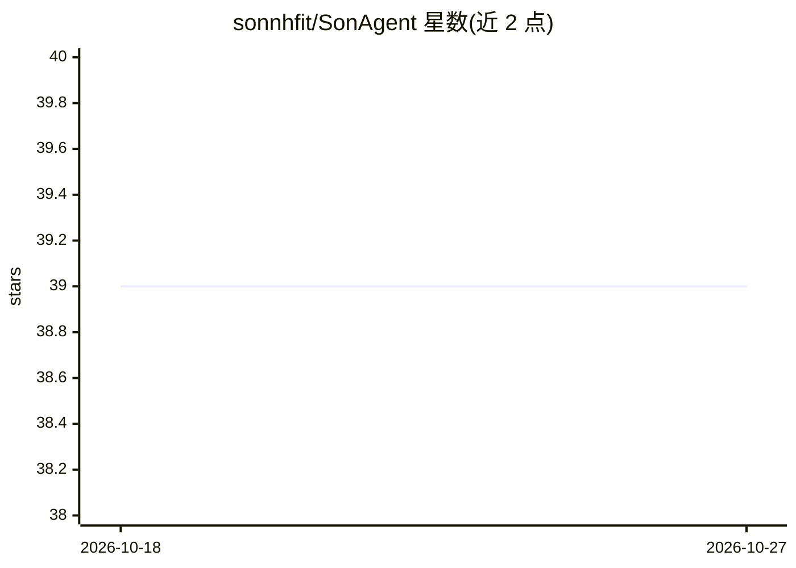

# sonnhfit/SonAgent

⭐ 39 · Python · MIT · 推送 2026-02-20 · [GitHub](https://github.com/sonnhfit/SonAgent) · [官网](https://sonagent.readthedocs.io) · 个人维护

**自主运行的个人数字助手 Agent，可自我修改源码**

基于 LLM 的自主 Agent，定位为个人'数字意识备份'：持续自主监控与守护数字存在，以信念系统为推理框架，可自动获取新信念、结合人类反馈学习，并支持加密备份。特色能力是自我修复——在人类批准下编辑并编译自身源码。通过 pip 安装，以 sonagent CLI 初始化（user_data 目录存技能与数据库）并运行，需在 config.json 填入 openai、telegram、github 的 API key；自带 TextPrinter、WeatherAPISkill 等标准技能，支持时区配置、Docker 与 Docker Compose 部署，CI 自动构建镜像推送到 GHCR。

## 筛选速览

| 维度 | 判定 | 备注 |
|---|---|---|
| AI 角色 | `ai-native` | 本体是模型或模型工具 |
| 许可风险 | `permissive` | MIT |
| 部署形态 | `self-host` | docker 或自建部署 |
| 模型依赖 | — | README 未给出锁定关系 |
| 硬件要求 | — | 无带数字的原话,不猜 |
| 安装摩擦 | `low` | 无编译、无系统依赖或容器化 |
| 成熟度 | — | 结构信号不足 |

## 能力要点

- 自主运行，持续监控守护，无需用户持续干预
- 自我修复：经人类批准编辑并编译自身源码
- 信念驱动推理 + 人类反馈学习机制
- 内置标准技能（TextPrinter、WeatherAPISkill、SkillBuilder 等），自动复制到用户目录

## 适用场景

- 想运行一个持续在线的个人自主 AI 助手
- 研究 Agent 自我编辑源码与自我修复机制
- 通过 Telegram 等渠道交互并由 Agent 自动提交 GitHub PR

## 场景标签

`AI 助手` · 领域:对话与助手

## 证据(README 行号)

> L3: ### Autonomous Agent for Digital Consciousness Backup Using Large Language Models (LLM)
> L6: The Digital Consciousness Backup Agent is an autonomous system designed to safeguard your digital consciousness on t
> L19: - **Self-Repairing source code** edits its own source code and compiles itself under human approval

## 星数曲线

2026-10-18 39 → 2026-10-27 39（+0）

---
*卡片 v1 · prompt 1.4 · 生成 2026-10-25 · 置信度 mid · 依据 README sha `421927a250c1` · [字段定义](../../DATASET.md)*
