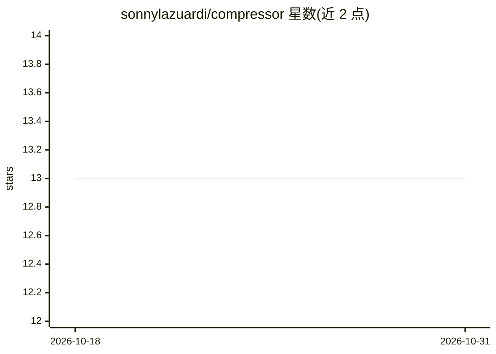

# sonnylazuardi/compressor

⭐ 13 · Zig · 推送 2026-07-12 · [GitHub](https://github.com/sonnylazuardi/compressor) · [官网](https://compressor.sonnylab.com/) · 个人维护

**原生桌面图片压缩工具：将常见图片转为 WebP（macOS/Windows）**

基于 Native SDK 的原生桌面图片压缩应用，界面用 app.native 标记、逻辑用 Zig 编写，不使用 WebView/React/浏览器 UI。功能包括：文件对话框或拖拽浏览图片、转换为 WebP、质量滑块（默认 80%）与 Light 90 / Medium 80 / Heavy 50 三档预设、快捷键操作。压缩由 Bun 的 image().webp() 完成，运行时仍需 Bun 在 PATH 上。支持 macOS 与 Windows，通过 GitHub Releases 分发 zip 安装包（macOS 临时签名、Windows 未签名）。

## 筛选速览

| 维度 | 判定 | 备注 |
|---|---|---|
| AI 角色 | `ai-enhanced` | 去掉 AI 部分产品仍成立 |
| 许可风险 | `none` | — |
| 部署形态 | `desktop` | 安装包/桌面程序 |
| 模型依赖 | — | README 未给出锁定关系 |
| 硬件要求 | — | 无带数字的原话,不猜 |
| 安装摩擦 | `low` | 无编译、无系统依赖或容器化 |
| 成熟度 | — | 结构信号不足 |

## 能力要点

- 原生桌面应用：无 WebView、无 React、无浏览器 UI
- 任意常见图片转 WebP，含质量滑块与三档预设
- Zig 编写逻辑（Model/Msg/update_fx 架构），Bun 负责编码
- GitHub Actions CI 构建 macOS arm64 与 Windows x64 安装包

## 适用场景

- 在桌面上快速把图片批量转成 WebP 减小体积
- 通过快捷键与拖拽快速压缩单张图片
- 体验 Native SDK + Zig 的原生桌面应用构建方式

## 场景标签

`图像视频处理` · 领域:感知与多模态

## 证据(README 行号)

> L7: Full **native** desktop image compressor — no WebView, no React, no browser UI.
> L11: - Encode: **Bun** `Bun.file(…).image().webp({ quality })` via `fx.spawn`

## 星数曲线

2026-10-18 13 → 2026-10-31 13（+0）

---
*卡片 v1 · prompt 1.4 · 生成 2026-10-31 · 置信度 mid · 依据 README sha `cec81fb0f1cf` · [字段定义](../../DATASET.md)*
