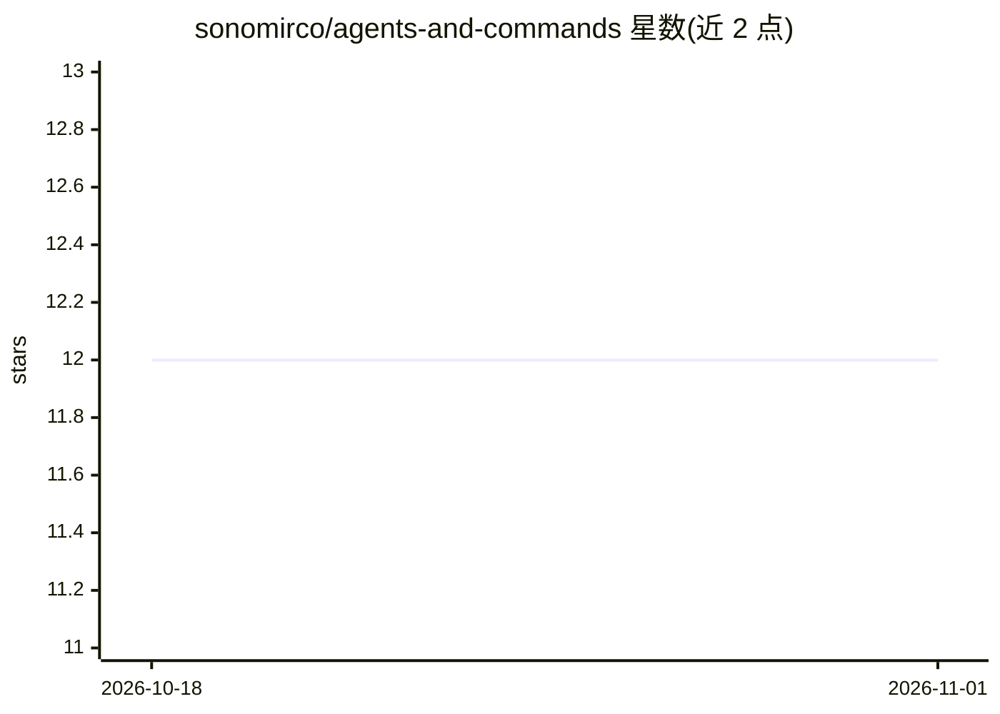

# sonomirco/agents-and-commands

⭐ 12 · Python · Apache-2.0 · 推送 2026-02-13 · [GitHub](https://github.com/sonomirco/agents-and-commands) · 个人维护

**面向 AEC 领域的 Claude Code/Codex 智能体与提示词策展仓库**

策展式仓库，收录 17 个专用子代理、2 个工作流命令、4 个提示词模板与 3 个技能，组织为 10 个插件，主要面向建筑、工程、施工（AEC）开发场景，同时覆盖通用编程（Python/C#/.NET、后端架构、TDD 等）。资源可通过 Claude Code marketplace 按插件粒度安装，或用 manifest 驱动脚本安装技能；AEC 分析技能可解析 Dynamo (.dyn) 与 Grasshopper (.ghx/.xml) 文件并生成 Markdown 报告，含 C# 迁移指引。plan-validator 代理支持通过 Codex 反馈循环迭代改进计划。

## 筛选速览

| 维度 | 判定 | 备注 |
|---|---|---|
| AI 角色 | `ai-knowledge` | 知识聚合/清单类 |
| 许可风险 | `permissive` | Apache-2.0 |
| 部署形态 | `None` |  |
| 模型依赖 | locked-api |  |
| 硬件要求 | — | 无带数字的原话,不猜 |
| 安装摩擦 | `medium` | 含编译或系统依赖之一 |
| 成熟度 | — | 结构信号不足 |

## 能力要点

- 17 个子代理/2 个命令/4 个提示词/3 个技能，组织为 10 个可按需安装的插件
- grasshopper-analyzer 与 dynamo-analyzer 解析 .ghx/.xml/.dyn 文件并生成拓扑与代码分析报告
- plan-validator 通过 Codex CLI/MCP 反馈循环迭代验证计划
- 安装途径：Claude Code marketplace、install-skills 脚本或手动复制到 ~/.claude/skills/

## 适用场景

- 在 Claude Code 中按需安装 AEC 分析插件处理 Dynamo/Grasshopper 脚本
- 日常开发中调用专用子代理做 TDD、后端架构设计与代码评审
- 用提示词模板设定写作精度与降幻觉约束

## 场景标签

`提示工程` `精选清单` · 领域:Agent 开发

## 证据(README 行号)

> L3: A curated repository of agent commands and prompt templates, specifically for the AEC (Architecture, Engineering, Co
> L9: - **17 specialized agents** across architecture, languages, testing, documentation, and AEC

## 星数曲线

2026-10-18 12 → 2026-11-01 12（+0）

---
*卡片 v1 · prompt 1.4 · 生成 2026-11-01 · 置信度 high · 依据 README sha `0e3e80b7e331` · [字段定义](../../DATASET.md)*
