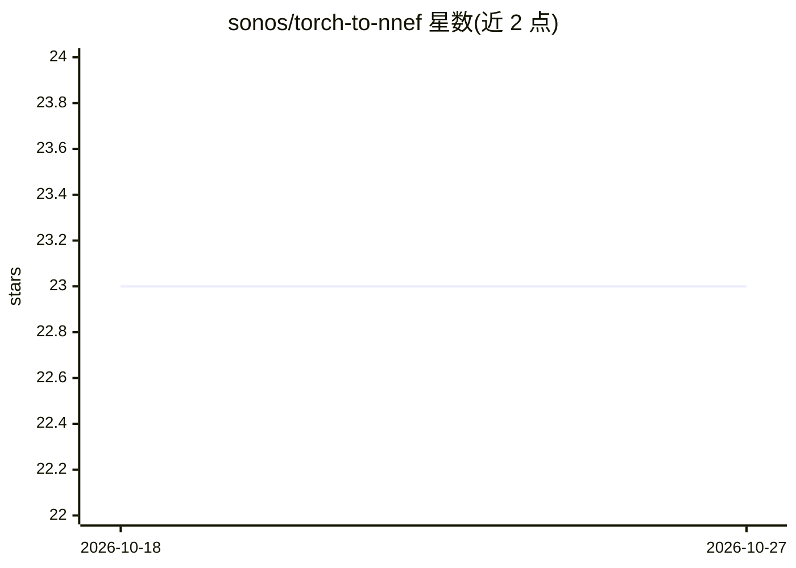

# sonos/torch-to-nnef

⭐ 23 · Python · NOASSERTION · 推送 2026-10-26 · [GitHub](https://github.com/sonos/torch-to-nnef) · [官网](https://sonos.github.io/torch-to-nnef) · 组织维护

**把 PyTorch 模型导出为 NNEF 交换格式的工具库**

面向需要模型移植与部署的开发者：追踪任意 nn.Module（含量化模型），生成可移植的 NNEF 压缩包。NNEF 图为人类可读文本、权重单独存放，便于审计与调试；主要目标推理引擎为 SONOS 开发的 tract，导出时可选 check_io 比对 tract 与 PyTorch 输出。支持 CNN、transformer、LLM、多模态、NeMo ASR 等导出场景。兼容 PyTorch>=1.10，Linux/macOS，MIT/Apache-2.0 双许可。以 pip 包提供。

## 筛选速览

| 维度 | 判定 | 备注 |
|---|---|---|
| AI 角色 | `ai-ecosystem` | LLM/agent 周边工具 |
| 许可风险 | `none` | NOASSERTION |
| 部署形态 | `library` | 以包/库形式分发 |
| 模型依赖 | — | README 未给出锁定关系 |
| 硬件要求 | — | 无带数字的原话,不猜 |
| 安装摩擦 | `low` | 无编译、无系统依赖或容器化 |
| 成熟度 | — | 结构信号不足 |

## 能力要点

- 追踪任意 nn.Module（含量化模型）生成 NNEF 压缩包
- 图与权重分离、graph.nnef 为纯文本可读
- check_io 在导出时比对 tract 与 PyTorch 输出
- 支持 LLM、多模态、NeMo ASR 等导出教程

## 适用场景

- 把训练好的 PyTorch 模型导出到 tract 等运行时部署
- 审查模型被序列化的算子内容
- 导出 LLM 或量化模型用于跨运行时推理

## 场景标签

 · 领域:深度学习工具链/模型交换格式

## 证据(README 行号)

> L5: Export any PyTorch model to NNEF, a simple and explicit neural network exchange format, in a way that is **auditable
> L7: `torch_to_nnef` traces a vanilla `nn.Module` (any internal tensor type, quantized models included) and produces a po

## 星数曲线

2026-10-18 23 → 2026-10-27 23（+0）

---
*卡片 v1 · prompt 1.4 · 生成 2026-10-27 · 置信度 high · 依据 README sha `ac0e36afd6c2` · [字段定义](../../DATASET.md)*
