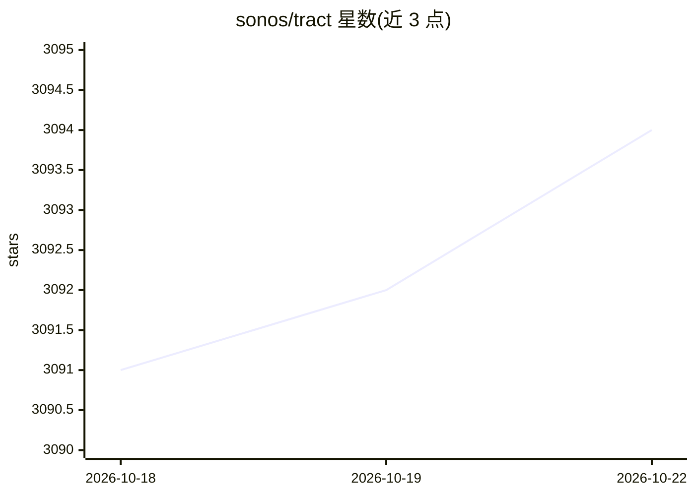

# sonos/tract

⭐ 3,094 · Rust · NOASSERTION · 推送 2026-10-21 · [GitHub](https://github.com/sonos/tract) · 组织维护

**Rust 神经网络推理引擎：加载 ONNX/NNEF 模型并在多平台运行**

Sonos 维护的自包含神经网络推理引擎，以 Rust crate 形式提供，另有同源 Python 包。加载 ONNX、NNEF、TFLite 与 TF1 冻结图模型，经 TypedModel IR 优化后运行于 x86/ARM CPU、Apple Metal、NVIDIA CUDA 与 WebAssembly。支持 pulsified 流式推理（唤醒词、流式 ASR）。部署工作流为构建期一次性转换为 NNEF（tract-OPL 中间格式），运行期仅随附小型运行时 crate，无需 protobuf 与训练框架加载器。Sonos 在生产中将其用于唤醒词与流式语音识别；TF2 不直接支持，需先转 ONNX。

## 筛选速览

| 维度 | 判定 | 备注 |
|---|---|---|
| AI 角色 | `ai-ecosystem` | LLM/agent 周边工具 |
| 许可风险 | `permissive` | NOASSERTION |
| 部署形态 | `library` | 以包/库形式分发 |
| 模型依赖 | — | README 未给出锁定关系 |
| 硬件要求 | — | 无带数字的原话,不猜 |
| 安装摩擦 | `medium` | 含编译或系统依赖之一 |
| 成熟度 | — | 结构信号不足 |

## 能力要点

- 加载 ONNX/NNEF/TFLite/TF1 模型并优化运行，覆盖 CPU/Metal/CUDA/WASM 四类运行时
- translate-once / ship-tiny-runtime 部署故事：运行期不依赖 protobuf 与训练框架
- pulsified 流式推理支持，同一模型可服务批量评估与低延迟实时推理
- 提供 Rust crate 与 PyPI Python 包，示例覆盖 LLM、文生图、ASR、目标检测

## 适用场景

- 在嵌入式 ARM 设备上部署优化的 ONNX 模型
- 构建期转换模型为 NNEF，运行期只随附小体积推理运行时
- 实现唤醒词或流式语音识别的低延迟推理
- 通过 WebAssembly 在浏览器中运行模型

## 场景标签

`推理引擎` · 领域:训练与推理

## 证据(README 行号)

> L13: tract loads ONNX and NNEF models, optimises them, and runs them anywhere —
> L81: All runtimes share the `TypedModel` IR and the same loaders, so a model

## 星数曲线

2026-10-18 3,091 → 2026-10-22 3,094（+3）

---
*卡片 v1 · prompt 1.4 · 生成 2026-10-20 · 置信度 high · 依据 README sha `e0c864c2b6ce` · [字段定义](../../DATASET.md)*
