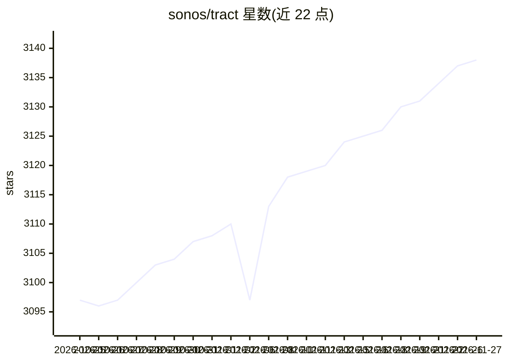

# sonos/tract

⭐ 3,138 · Rust · NOASSERTION · 推送 2026-11-26 · [GitHub](https://github.com/sonos/tract) · 组织维护

**给开发者的轻量级 Rust 神经网络推理引擎，加载并运行 ONNX/NNEF 模型**

Sonos 开源的神经网络推理引擎，读取 ONNX、NNEF（含 tract-OPL 扩展）及 legacy TFLite/TF1 模型，优化后在 CPU（x86/ARM/RISC-V）、Apple Metal、NVIDIA CUDA 和 WebAssembly 上运行；在 Sonos 生产环境用于 wake-word 与流式语音识别，也覆盖 LLM、文生图、CV 模型。核心机制是

## 筛选速览

| 维度 | 判定 | 备注 |
|---|---|---|
| AI 角色 | `ai-ecosystem` | LLM/agent 周边工具 |
| 许可风险 | `permissive` | NOASSERTION |
| 部署形态 | `library` | 以包/库形式分发 |
| 模型依赖 | — | README 未给出锁定关系 |
| 硬件要求 | — | 无带数字的原话,不猜 |
| 安装摩擦 | `medium` | 含编译或系统依赖之一 |
| 成熟度 | — | 结构信号不足 |

## 能力要点

- 读取 ONNX/NNEF/TFLite(legacy)/TF1(legacy) 模型格式，NNEF 支持加载与保存
- 提供 pulsification 流式推理机制，同一模型可服务批量与低延迟实时场景
- CPU/Metal/CUDA/WebAssembly 多运行时共享 TypedModel IR，模型可跨平台迁移
- 提供 Rust crate 与 PyPI 上的 Python 包两种使用方式

## 适用场景

- 在嵌入式 ARM/嵌入式设备上部署 wake-word、流式 ASR 等实时推理
- 构建后转换为 NNEF、运行时只带小体积 runtime 的边缘部署
- 在浏览器中经 WebAssembly 运行模型推理
- 推理运行 CV 目标检测、人脸识别、文本生成、文生图模型

## 场景标签

`推理引擎` · 领域:训练与推理

## 证据(README 行号)

> L12: Sonos' neural-network inference engine.
> L14: tract loads ONNX and NNEF models, optimises them, and runs them anywhere —

## 星数曲线

2026-10-25 3,097 → 2026-11-27 3,138（+41）

---
*卡片 v1 · prompt 1.4 · 生成 2026-11-23 · 置信度 high · 依据 README sha `d7a361920a1f` · [字段定义](../../DATASET.md)*
