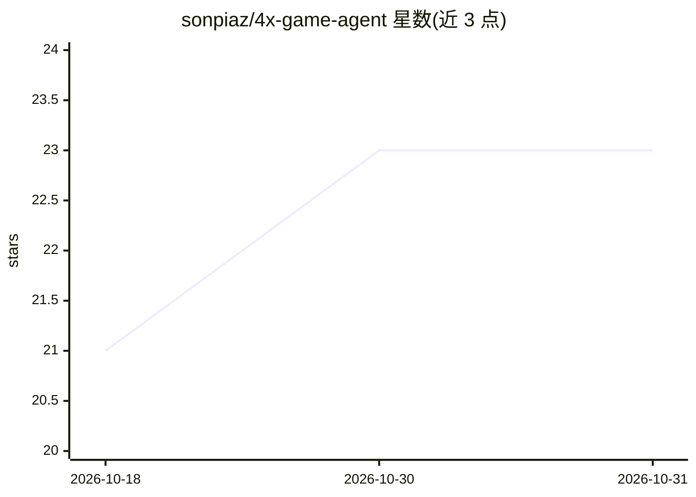

# sonpiaz/4x-game-agent

⭐ 23 · Python · MIT · 推送 2026-03-15 · [GitHub](https://github.com/sonpiaz/4x-game-agent) · 个人维护

**驱动 AI 机器人游玩 4X 手游策略游戏的代理框架**

Python 框架，用于构建自动游玩 4X 移动策略游戏（Kingshot、Rise of Kingdoms、Evony 等）的机器人。采用 5 层混合架构：ADB 截图 + 像素分类 + OCR 感知、状态机处理弹窗、世界模型跟踪定时器、脚本化工作流执行操作，LLM 视觉仅在卡住或需要战略规划时介入（Claude Sonnet 每 30 分钟审查、Claude Haiku 故障回退），以降低调用成本。目前仅 Kingshot 为参考实现，其余游戏为计划中。需要 Android 模拟器与 ADB 连接。

## 筛选速览

| 维度 | 判定 | 备注 |
|---|---|---|
| AI 角色 | `ai-native` | 本体是模型或模型工具 |
| 许可风险 | `permissive` | MIT |
| 部署形态 | `library` | 以包/库形式分发 |
| 模型依赖 | locked-api |  |
| 硬件要求 | — | 无带数字的原话,不猜 |
| 安装摩擦 | `low` | 无编译、无系统依赖或容器化 |
| 成熟度 | — | 结构信号不足 |

## 能力要点

- 5 层混合架构：OCR/FSM/世界模型/工作流/LLM 视觉
- 本地感知处理大部分决策，LLM 仅在卡住或战略审查时介入
- YAML 配置驱动，附带游戏模板可添加新游戏
- 提供 localhost:8080 实时监控的 Web 仪表板

## 适用场景

- 为 Kingshot 等 4X 手游搭建自动游玩机器人
- 基于模板扩展支持自己的 4X 策略游戏
- 通过 Web 仪表板实时监控机器人运行状态

## 场景标签

`Agent 框架` `GUI 自动化` · 领域:Agent 开发

## 证据(README 行号)

> L3: **LLM-powered AI agent framework for 4X mobile strategy games.**
> L30: LAYER 5: STRATEGIC AI ──── LLM vision review (every 30 min, ~$0.004)
> L100: 7. **AI review** every 30 min — Claude Sonnet checks if strategy is on track

## 星数曲线

2026-10-18 21 → 2026-10-31 23（+2）

---
*卡片 v1 · prompt 1.4 · 生成 2026-10-28 · 置信度 high · 依据 README sha `13e671cfcb91` · [字段定义](../../DATASET.md)*
