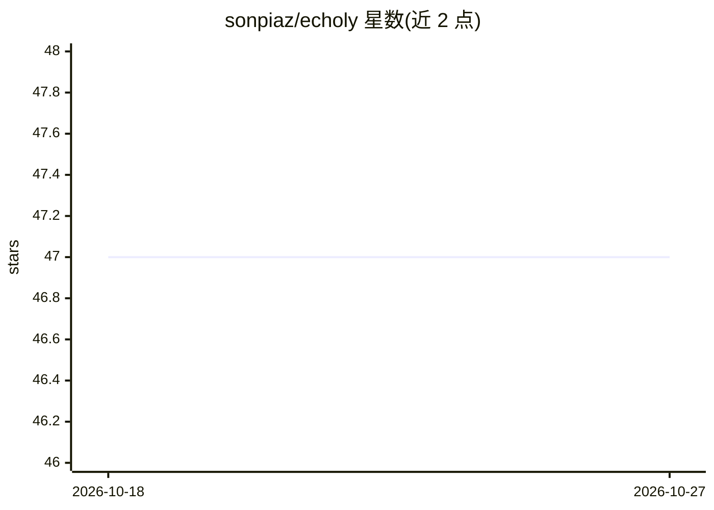

# sonpiaz/echoly

⭐ 47 · JavaScript · MIT · 推送 2026-09-13 · [GitHub](https://github.com/sonpiaz/echoly) · [官网](https://kymaapi.com) · 个人维护

**给普通观众的 YouTube 实时 AI 配音翻译 Chrome 扩展**

Chrome MV3 扩展，在 YouTube 视频上叠加实时 AI 配音与字幕面板。提供两档延迟：Realtime 档走 WebRTC P2P 连接 OpenAI Realtime（亚秒延迟、9 种声音或自动克隆说话人）；Standard 档用 Whisper→Gemini→TTS 分块流水线（约 5 秒延迟、5 种精选声音）。支持 13 种目标语言，无账号、无遥测、无自建服务器，全部调用经用户自己的 Kyma API key 完成，音频直接发送至 Kyma 与 OpenAI。可从源码以开发者模式加载，Chrome 商店上架审核中。

## 筛选速览

| 维度 | 判定 | 备注 |
|---|---|---|
| AI 角色 | `ai-native` | 本体是模型或模型工具 |
| 许可风险 | `permissive` | MIT |
| 部署形态 | `None` |  |
| 模型依赖 | — | README 未给出锁定关系 |
| 硬件要求 | — | 无带数字的原话,不猜 |
| 安装摩擦 | `low` | 无编译、无系统依赖或容器化 |
| 成熟度 | — | 结构信号不足 |

## 能力要点

- 两档延迟：Realtime（WebRTC 亚秒级）与 Standard（约 5s 分块流水线）
- 支持 13 种目标语言，5 种多语言精选声音
- 自带 Kyma key 运行，无账号、无遥测、无 Echoly 服务器
- 可拖拽/缩放的页内面板、翻译历史、双音量独立控制

## 适用场景

- 看外语 YouTube 视频时听到自己语言的实时配音
- 跟读外语内容时同时查看原文与译文面板
- 用自己持有的 API key 按用量付费使用同传

## 场景标签

`语音合成` `语音识别` · 领域:内容生成

## 证据(README 行号)

> L7: Chrome MV3 extension that overlays a live AI voice-over onto any YouTube video. Two tiers:
> L9: - **Realtime** — WebRTC P2P, sub-second lag, 9 OpenAI voices or auto-clone of the speaker. ~$0.46 / 10 min.
> L10: - **Standard** — chunked pipeline (Whisper → Gemini → text to speech), ~5s lag, 5 curated multilingual voices. ~$0.

## 星数曲线

2026-10-18 47 → 2026-10-27 47（+0）

---
*卡片 v1 · prompt 1.4 · 生成 2026-10-25 · 置信度 high · 依据 README sha `36e959acf6ca` · [字段定义](../../DATASET.md)*
