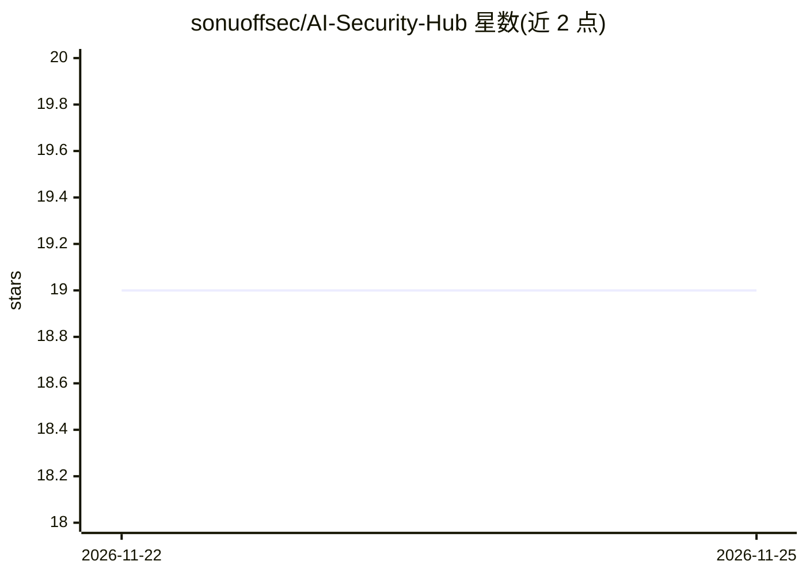

# sonuoffsec/AI-Security-Hub

⭐ 19 · MIT · 推送 2026-06-14 · [GitHub](https://github.com/sonuoffsec/AI-Security-Hub) · 个人维护

**AI/LLM/Agent/MCP 安全资源库：payload、速查表、实验与 CTF**

面向 AI 安全学习与实践的资源聚合仓库，收录提示注入、越狱、RAG 投毒、Agent 工具滥用与 MCP 攻击的 payload 集合（每条含目标、技术、风险级别与检测说明）、可打印速查表、按难度分级的安全实验环境列表（含官方实验环境 DVAP）、安全工具目录、CTF 平台清单与学习路径、论文与标准数据库。MIT 许可，社区贡献驱动；自身以文档/清单为主，实验环境 DVAP 通过 git clone 与 docker compose 部署。

## 筛选速览

| 维度 | 判定 | 备注 |
|---|---|---|
| AI 角色 | `ai-knowledge` | 知识聚合/清单类 |
| 许可风险 | `permissive` | MIT |
| 部署形态 | `self-host` | docker 或自建部署 |
| 模型依赖 | — | README 未给出锁定关系 |
| 硬件要求 | — | 无带数字的原话,不猜 |
| 安装摩擦 | `low` | 无编译、无系统依赖或容器化 |
| 成熟度 | — | 结构信号不足 |

## 能力要点

- 按 prompt-injection/jailbreaks/rag-attacks/agent-attacks/mcp-attacks 分类的 payload 集合
- 5 类安全速查表：注入、RAG、Agent、MCP、红队方法
- 官方配套实验环境 DVAP（docker compose 部署）覆盖 6 类攻击场景
- 分 Beginner/Intermediate/Advanced 的学习路径与论文数据库

## 适用场景

- 准备 AI 红队或渗透测试时查找对应攻击 payload
- 从零开始按学习路径系统学习 AI 安全
- 为安全培训搭建可动手操作的漏洞 AI 实验（DVAP）
- 检索 MCP、RAG、Agent 相关攻击技术与防御资料

## 场景标签

`网络安全` `精选清单` · 领域:学习与行业

## 证据(README 行号)

> L34: This is the PayloadsAllTheThings + SecLists + OWASP Cheat Sheets of the AI Security world, combined into one ecosys
> L150: > SecLists-style payload collection for AI security testing.
> L289: > Structured roadmap from zero to AI security expert. Full paths: learning-paths/README.md

## 星数曲线

2026-11-22 19 → 2026-11-25 19（+0）

---
*卡片 v1 · prompt 1.4 · 生成 2026-11-22 · 置信度 mid · 依据 README sha `98267d87e8e2` · [字段定义](../../DATASET.md)*
