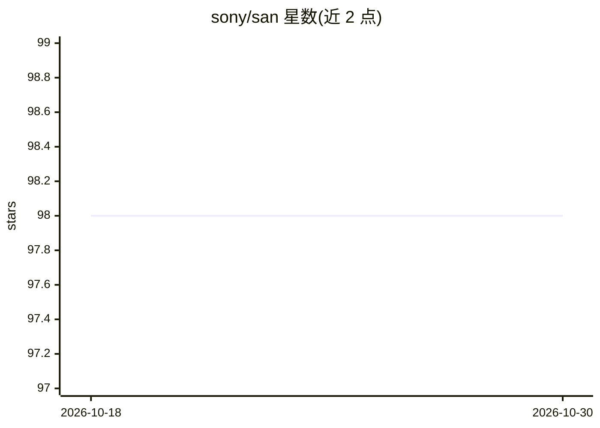

# sony/san

⭐ 98 · Python · 推送 2025-12-01 · [GitHub](https://github.com/sony/san) · 组织维护

**ICLR 2024 论文 SAN 的官方 PyTorch 实现（GAN 训练方法）**

Sony 维护的 Slicing Adversarial Network（SAN）官方 PyTorch 代码库，对应 ICLR 2024 论文（arXiv 2301.12811）。SAN 是一种 GAN 训练方案：通过判别器归一化线性层，将 GAN 与切片最优传输连接，使判别器可作为分布间距离；论文称对现有 GAN 只需简单修改即可转换为 SAN，并在 CIFAR10 与 ImageNet 256x256 上应用于 StyleGAN-XL。README 仅含论文摘要与引用信息，未给出安装运行说明。

## 筛选速览

| 维度 | 判定 | 备注 |
|---|---|---|
| AI 角色 | `ai-native` | 本体是模型或模型工具 |
| 许可风险 | `none` | — |
| 部署形态 | `None` |  |
| 模型依赖 | — | README 未给出锁定关系 |
| 硬件要求 | — | 无带数字的原话,不猜 |
| 安装摩擦 | `low` | 无编译、无系统依赖或容器化 |
| 成熟度 | — | 结构信号不足 |

## 能力要点

- 论文 "SAN: Inducing Metrizability of GAN with Discriminative Normalized Linear Layer" 的官方实现
- 基于切片最优传输理论提出判别器可度量化条件与 SAN 训练方案
- 应用于 StyleGAN-XL 做类别条件生成（CIFAR10 / ImageNet 256）

## 适用场景

- 复现论文中的 SAN 训练实验
- 将现有 GAN 训练代码改造为 SAN 方案
- 研究生成模型与切片 Wasserstein 距离相关工作

## 场景标签

`图像生成` · 领域:内容生成

## 证据(README 行号)

> L1: # Slicing Adversarial Network (SAN) [ICLR 2024]
> L3: This repository contains the official PyTorch implementation of **"SAN: Inducing Metrizability of GAN with Discrimin

## 星数曲线

2026-10-18 98 → 2026-10-30 98（+0）

---
*卡片 v1 · prompt 1.4 · 生成 2026-10-23 · 置信度 high · 依据 README sha `8869318aef21` · [字段定义](../../DATASET.md)*
