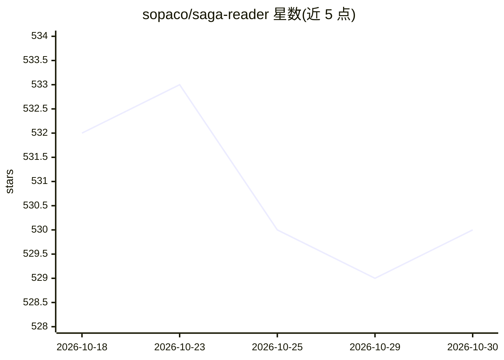

# sopaco/saga-reader

⭐ 530 · Rust · MIT · 推送 2026-07-11 · [GitHub](https://github.com/sopaco/saga-reader) · [官网](https://aiqino.netlify.app/) · 个人维护 · 中文 README

**AI 驱动的智库式互联网阅读器桌面应用**

基于 Rust、Tauri 与 Svelte 构建的跨平台（Windows/Mac/Linux）桌面阅读应用：按用户兴趣关键词自动从全网检索与 RSS 采集内容，调用云端或本地大模型做摘要与导读，提供阅读中与 AI 对话的伴读功能、多语言自动翻译；所有数据存储在本地。内置 ollama 模块管理本地模型实例与模型更新。官方称内存占用低于 10MB，可在老旧设备运行。首次使用需参照帮助文档配置大模型。

## 筛选速览

| 维度 | 判定 | 备注 |
|---|---|---|
| AI 角色 | `ai-native` | 本体是模型或模型工具 |
| 许可风险 | `permissive` | MIT |
| 部署形态 | `None` |  |
| 模型依赖 | local-ok | 支持本地模型 |
| 硬件要求 | — | 无带数字的原话,不猜 |
| 安装摩擦 | `low` | 无编译、无系统依赖或容器化 |
| 成熟度 | — | 结构信号不足 |

## 能力要点

- 基于关键词的兴趣订阅与全网自动检索（Rust 实现）
- 云端与本地大模型接入，含 ollama 实例与模型管理模块
- AI 伴读对话与多语言自动翻译
- 数据全部本地存储，官方称内存占用低于 10MB

## 适用场景

- 按兴趣关键词订阅并自动获取全网资讯
- 阅读时与 AI 对话提问、获得内容导读
- 接入本地模型在离线/隐私场景下做摘要

## 场景标签

`聊天机器人` `AI 助手` · 领域:对话与助手

## 证据(README 行号)

> L21: **Saga Reader** is an AI-driven think tank-style reader that automatically retrieves information from the internet 
> L56: - **Multi - Model AI Support**: Supports connecting to cloud - based and local large - scale models for inference. 

## 星数曲线

2026-10-18 532 → 2026-10-30 530（-2）

---
*卡片 v1 · prompt 1.4 · 生成 2026-10-22 · 置信度 high · 依据 README sha `9d2db059ed7b` · [字段定义](../../DATASET.md)*
