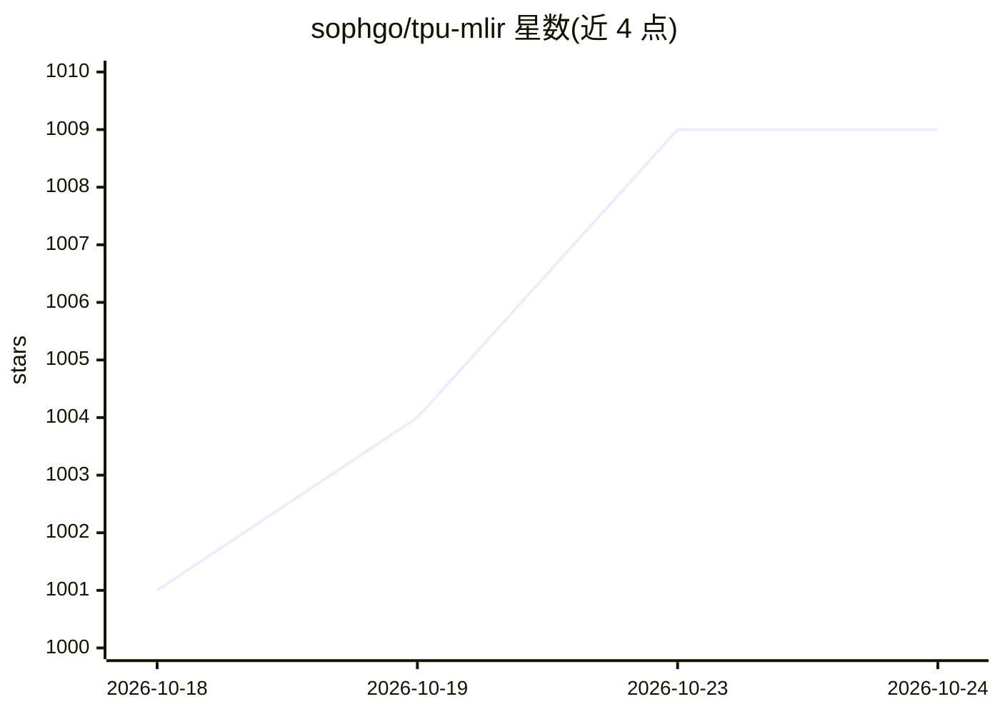

# sophgo/tpu-mlir

⭐ 1,009 · C++ · NOASSERTION · 推送 2026-10-15 · [GitHub](https://github.com/sophgo/tpu-mlir) · 组织维护 · 中文 README

**面向 Sophgo TPU 的 MLIR 机器学习编译器：模型转 bmodel**

基于 MLIR 的开源机器学习编译器，将 PyTorch、ONNX、TFLite、Caffe 等框架的预训练模型编译为在 TPU 上运行的 bmodel 文件，面向 Sophgo 算能 TPU 芯片（bm1684x/bm1688/cv186ah）的模型部署开发者。提供统一 IR 与 Top/Tpu 两级 dialect 的降级流水线，支持 F32/BF16/F16/INT8 量化、校准、QAT，以及 AWQ/GPTQ/AutoRound 预量化 LLM 的一次式转换。运行于预构建 Docker 镜像内，可 pip 安装 wheel 或源码编译。

## 筛选速览

| 维度 | 判定 | 备注 |
|---|---|---|
| AI 角色 | `ai-ecosystem` | LLM/agent 周边工具 |
| 许可风险 | `none` | NOASSERTION |
| 部署形态 | `self-host` | docker 或自建部署 |
| 模型依赖 | — | README 未给出锁定关系 |
| 硬件要求 | — | 无带数字的原话,不猜 |
| 安装摩擦 | `low` | 无编译、无系统依赖或容器化 |
| 成熟度 | — | 结构信号不足 |

## 能力要点

- 多框架前端：PyTorch/ONNX/TFLite/Caffe，其他框架经 ONNX
- llm_convert.py 一次式转换 HuggingFace LLM（Qwen、MiniCPM-V 等）
- F32/BF16/F16/INT8 全量化工具链含校准与 QAT
- 附带 model_runner、model_tool、精度验证、模拟器等工具

## 适用场景

- 把预训练模型量化并编译为算能 TPU 上运行的 bmodel
- 在 BM1684X 等边缘设备上部署 HuggingFace LLM 或 YOLO 检测模型
- 编译前做 INT8 校准与精度对比验证

## 场景标签

`模型量化` `推理引擎` · 领域:训练与推理

## 证据(README 行号)

> L5:  An open-source, MLIR-based machine-learning compiler for TPUs.
> L20: **TPU-MLIR** converts pre-trained neural networks from mainstream frameworks into `bmodel` files that run efficient

## 星数曲线

2026-10-18 1,001 → 2026-10-24 1,009（+8）

---
*卡片 v1 · prompt 1.4 · 生成 2026-10-21 · 置信度 high · 依据 README sha `2e66fe072f7d` · [字段定义](../../DATASET.md)*
