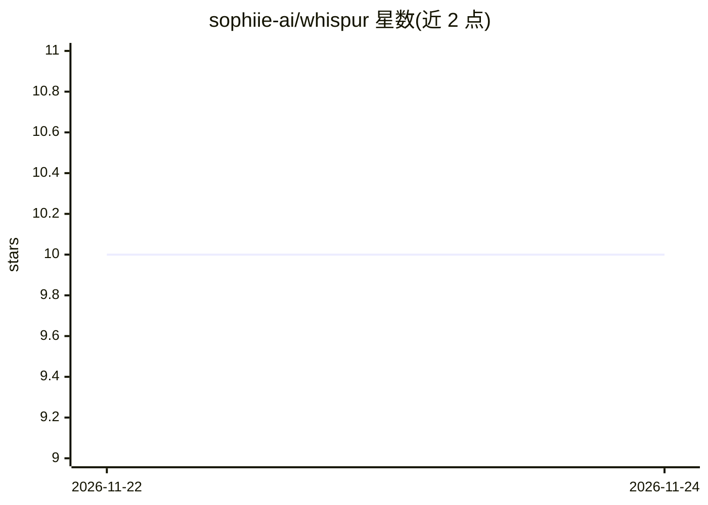

# sophiie-ai/whispur

⭐ 10 · Swift · MIT · 推送 2026-11-24 · [GitHub](https://github.com/sophiie-ai/whispur) · [官网](https://whispur.app) · 组织维护

**macOS 菜单栏语音输入应用：按住快捷键说话即转写粘贴**

常驻 macOS 菜单栏的听写工具：按住或切换快捷键录音，转写后可选用 LLM 清理文稿，并粘贴回当前光标所在应用（保留剪贴板）。默认本地优先——无云端 key 时在 Apple silicon 上用 NVIDIA Parakeet（经 Neural Engine）、Intel Mac 上用 Apple 端内识别，无需 API key 即可使用；另支持 7 种云端 STT 与 5 种 LLM 清理提供商，API key 存于 Keychain。带 Activity 日志、失败重试（录音保留 24 小时）、自定义词典与清理提示词、清理效果 eval 脚本。

## 筛选速览

| 维度 | 判定 | 备注 |
|---|---|---|
| AI 角色 | `ai-native` | 本体是模型或模型工具 |
| 许可风险 | `permissive` | MIT |
| 部署形态 | `None` |  |
| 模型依赖 | — | README 未给出锁定关系 |
| 硬件要求 | — | 无带数字的原话,不猜 |
| 安装摩擦 | `low` | 无编译、无系统依赖或容器化 |
| 成熟度 | — | 结构信号不足 |

## 能力要点

- 本地优先：Apple silicon 上经 Neural Engine 运行 NVIDIA Parakeet（25 种欧洲语言，无 key），Intel Mac 用 Apple 端内识别
- 多提供商 STT 矩阵：OpenAI/Groq/Deepgram/ElevenLabs/Mistral/Meta Muse 等经 API key 接入，部分支持实时流式文字
- 可选 LLM 文稿清理（Claude/OpenAI/Groq/Cerebras/Bedrock），可关闭后原样粘贴，并提供 Use raw 撤回
- 自定义词典含『heard as』误听映射；eval-cleanup.py 脚本可用自有听写数据评分清理提示词

## 适用场景

- 在任意 macOS 应用中用语音代替键盘输入文字
- 无网络或不想用云服务时在本机离线转写
- 技术听写：通过词典与提示词让专业术语、口述符号被正确转写
- 复盘与改进听写质量：Activity 日志标记可疑结果并用 eval 脚本调优

## 场景标签

`语音识别` · 领域:感知与多模态

## 证据(README 行号)

> L3: Whispur is a macOS menu-bar dictation app that turns speech into polished text and drops it straight back into the a
> L5: Hold a shortcut to talk, or use an optional toggle shortcut for hands-free capture. Whispur records, transcribes, op
> L30: - Local-first by default: with no cloud speech key, Whispur uses NVIDIA Parakeet on Apple silicon (Apple on-device 

## 星数曲线

2026-11-22 10 → 2026-11-24 10（+0）

---
*卡片 v1 · prompt 1.4 · 生成 2026-11-22 · 置信度 high · 依据 README sha `90c816ef4206` · [字段定义](../../DATASET.md)*
