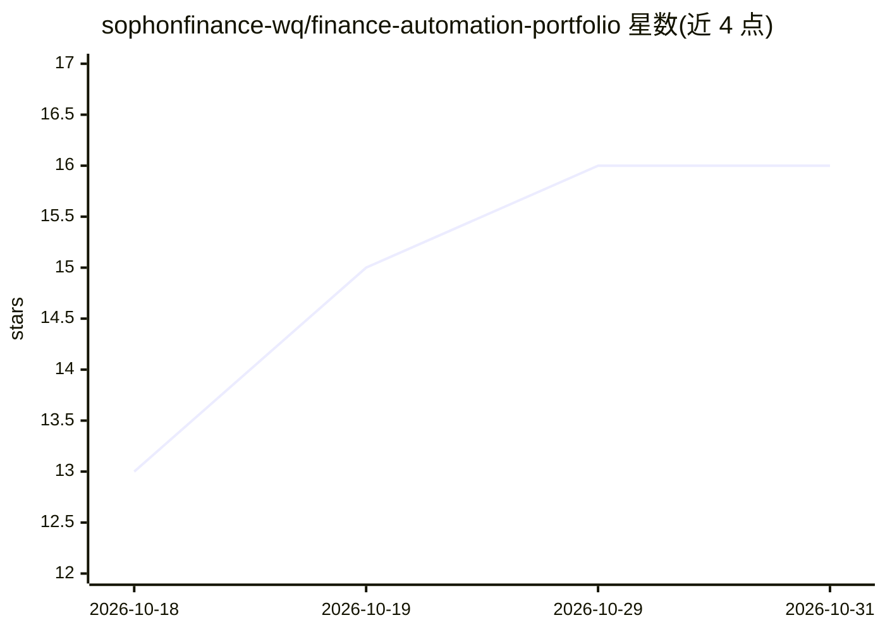

# sophonfinance-wq/finance-automation-portfolio

⭐ 16 · Python · MIT · 推送 2026-10-11 · [GitHub](https://github.com/sophonfinance-wq/finance-automation-portfolio) · [官网](https://sophonfinance.com) · 个人维护

**52 个财务与税务自动化引擎组合，含 AI 多角色复核框架**

Sophon Finance Systems 提供 52 个自包含 Python 系统，覆盖月结、现金/债务对账、合伙企业 1065、跨境盈余与 ACB、只读工作底稿校验等财务与税务自动化场景，全部运行在种子化虚构数据上。其中 Triangulate 是多 agent LLM 复核框架，采用编制/复核/专家/确定性审计/人工签核的职责分离与严重度到裁决的闸门；Knowledge Brain 从会议纪要构建带逐字引用的知识库。514,936 个测试用例由 CI 门控，MIT 许可。

## 筛选速览

| 维度 | 判定 | 备注 |
|---|---|---|
| AI 角色 | `ai-enhanced` | 去掉 AI 部分产品仍成立 |
| 许可风险 | `permissive` | MIT |
| 部署形态 | `library` | 以包/库形式分发 |
| 模型依赖 | — | README 未给出锁定关系 |
| 硬件要求 | — | 无带数字的原话,不猜 |
| 安装摩擦 | `low` | 无编译、无系统依赖或容器化 |
| 成熟度 | — | 结构信号不足 |

## 能力要点

- 52 个自包含财务/税务自动化引擎，运行于种子化虚构数据
- Triangulate 多 agent LLM 复核框架：确定性审计 + 人工签核闸门
- 月结引擎含 10 项控制并经 12 种错误注入验证
- 514,936 个测试用例 CI 门控，约 172 万生成用例的属性扫描

## 适用场景

- 自动化月度结账并对账现金、债务与银行流水
- 编制合伙企业 1065 与 §704(c) 税表映射
- 用多角色复核框架拦截 AI 产出中的幻觉数字
- 从会议纪要构建带逐字引用的知识库

## 场景标签

`多智能体` `工作流自动化` `知识库管理` · 领域:Agent 开发

## 证据(README 行号)

> L14: Fifty-two self-contained Python systems for finance and tax work — month-end close, cash/debt
> L17: finance operations atlas. One of them, **Triangulate**, is a multi-agent LLM review framework with a
> L19: fictional data, is covered by CI, and is built on one rule: **no material output rests on a single

## 星数曲线

2026-10-18 13 → 2026-10-31 16（+3）

---
*卡片 v1 · prompt 1.4 · 生成 2026-10-30 · 置信度 mid · 依据 README sha `0543df3e9192` · [字段定义](../../DATASET.md)*
