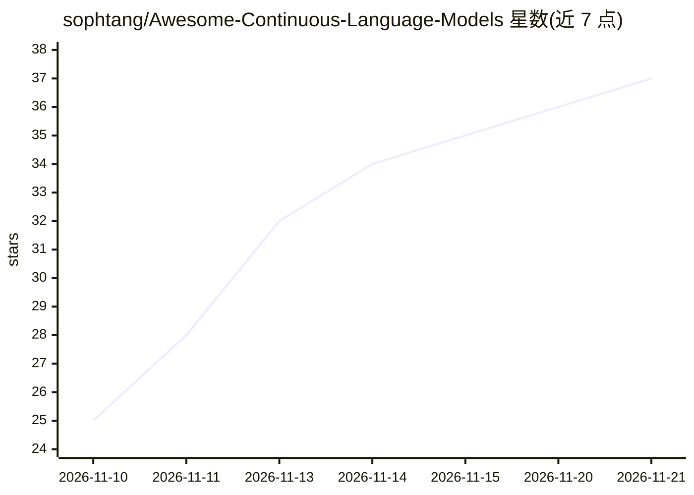

# sophtang/Awesome-Continuous-Language-Models

⭐ 37 · 推送 2026-11-20 · [GitHub](https://github.com/sophtang/Awesome-Continuous-Language-Models) · [官网](https://continuous-lm.github.io/) · 组织维护

**连续扩散与流语言模型论文策展清单（配合综述维护）**

配合综述论文《A Survey on Continuous Diffusion and Flow Language Models》维护的论文合集：收录连续语言模型（将噪声变换为 token 连续表示再解码的生成方式）相关论文，按词表嵌入、上下文/潜在空间、单纯形与球面等模型家族组织，提供代表模型总表（含表示方式、公式、损失、少步生成等字段）与 114 篇补充论文列表，并提供交互式论文地图演示。由宾夕法尼亚大学、KAIST、阿姆斯特丹大学研究者维护，收录论文含 alphaXiv/arXiv/代码链接。

## 筛选速览

| 维度 | 判定 | 备注 |
|---|---|---|
| AI 角色 | `ai-knowledge` | 知识聚合/清单类 |
| 许可风险 | `none` | — |
| 部署形态 | `None` |  |
| 模型依赖 | — | README 未给出锁定关系 |
| 硬件要求 | — | 无带数字的原话,不猜 |
| 安装摩擦 | `low` | 无编译、无系统依赖或容器化 |
| 成熟度 | — | 结构信号不足 |

## 能力要点

- 代表模型总表含表示方式、公式、主损失、少步生成与关键特性字段
- 114 篇补充论文按模型家族分组、按时间倒序排列
- 提供交互式论文地图演示与综述论文入口
- 跟踪文献截止日期（2026-11-02）后新增论文

## 适用场景

- 查找连续扩散/流语言模型方向的论文与代码
- 按表示方式或模型家族比较各方法
- 跟进该领域最新发表的论文

## 场景标签

`精选清单` · 领域:学习与行业

## 证据(README 行号)

> L3: **The paper collection for our survey, *A Survey on Continuous Diffusion and Flow Language Models*.**
> L29: > Continuous language models generate text by transforming noise into continuous representations of tokens, then de

## 星数曲线

2026-11-10 25 → 2026-11-21 37（+12）

---
*卡片 v1 · prompt 1.4 · 生成 2026-11-18 · 置信度 high · 依据 README sha `9d5da17db0d3` · [字段定义](../../DATASET.md)*
