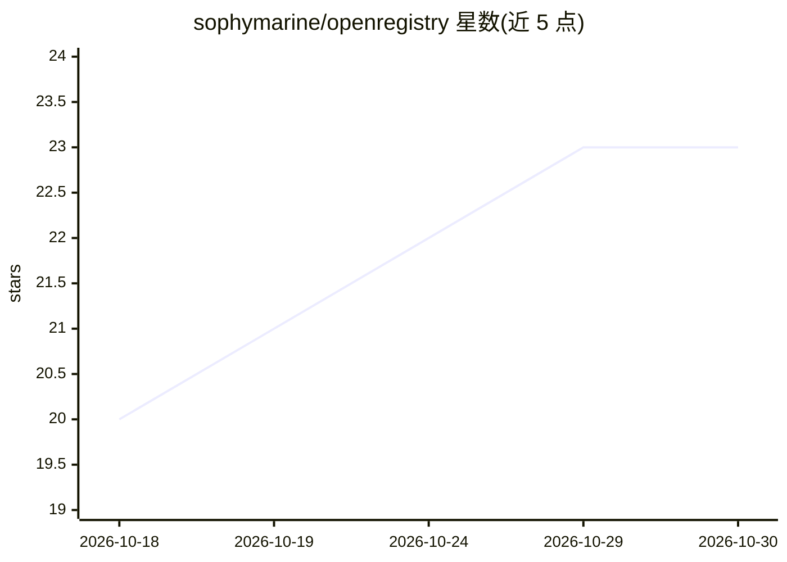

# sophymarine/openregistry

⭐ 23 · JavaScript · Apache-2.0 · 推送 2026-10-16 · [GitHub](https://github.com/sophymarine/openregistry) · [官网](https://openregistry.sophymarine.com) · 组织维护

**接入 80+ 国官方公司登记处的实时数据 MCP 服务器与 API**

由 Sophymarine 运营的托管 MCP 服务（https://openregistry.sophymarine.com/mcp）：AI agent 可实时直连约 80+ 个国家/地区政府公司登记机构（英国 Companies House、法国 RNE、韩国等），查询公司档案、董事、股东、押记、备案文件与财报原文。数据按登记处原始格式逐字返回，不做归一化或缓存，支持跨司法辖区股权链穿透查询。提供免费额度与付费配额；部分受益所有权登记因 CJEU C-37/20 等法规限制不代理，返回 501 与替代入口。附 10 个 Claude Agent Skills 与同名 MCP prompts。

## 筛选速览

| 维度 | 判定 | 备注 |
|---|---|---|
| AI 角色 | `ai-ecosystem` | LLM/agent 周边工具 |
| 许可风险 | `permissive` | Apache-2.0 |
| 部署形态 | `None` |  |
| 模型依赖 | — | README 未给出锁定关系 |
| 硬件要求 | — | 无带数字的原话,不猜 |
| 安装摩擦 | `low` | 无编译、无系统依赖或容器化 |
| 成熟度 | — | 结构信号不足 |

## 能力要点

- 实时直连 80+ 官方政府登记处，返回未修改的原始数据与备案文件字节
- 单次会话内跨辖区穿透股权链至最终受益个人
- 结构化错误响应（429 限流/501 法定限制/上游错误）供 agent 分支处理
- 10 个预置工作流技能（KYC 尽调、UBO 链穿透、空壳公司检测等）兼作 MCP prompts

## 适用场景

- KYC/尽调时穿透跨境股权结构找到最终受益人
- 调查记者与数据新闻工作者核实公司档案与原始备案文件
- 合规团队筛查董事网络、PEP 与壳公司信号
- 在 Claude Desktop、Cursor、Cline 等 MCP 客户端中直接查询公司登记数据

## 场景标签

 · 领域:企业信息/合规尽调数据服务

## 证据(README 行号)

> L11: Real-time direct access to unmodified data and raw filings of about 80+ official government registries via MCP.
> L27: **We return the registry's own response — unmodified.** Every field name, every status value, every raw filing byte
> L179: OpenRegistry works with every major MCP-capable client. The same `https://openregistry.sophymarine.com/mcp` endpoi

## 星数曲线

2026-10-18 20 → 2026-10-30 23（+3）

---
*卡片 v1 · prompt 1.4 · 生成 2026-10-27 · 置信度 high · 依据 README sha `2dc2413bcf2e` · [字段定义](../../DATASET.md)*
