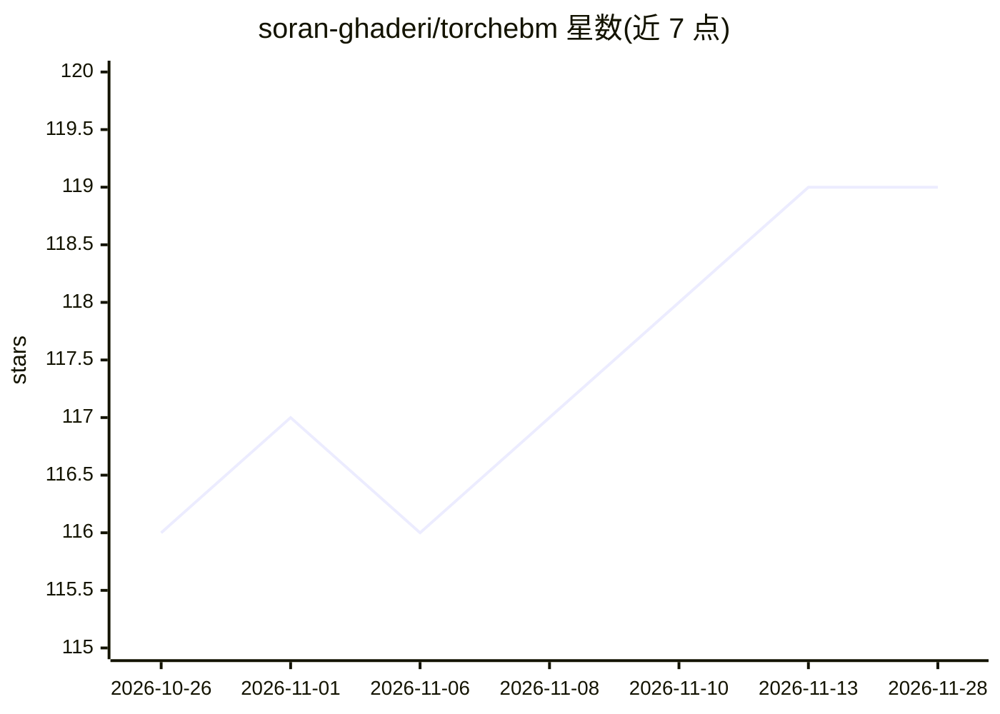

# soran-ghaderi/torchebm

⭐ 119 · Python · MIT · 推送 2026-11-23 · [GitHub](https://github.com/soran-ghaderi/torchebm) · [官网](https://soran-ghaderi.github.io/torchebm/) · 个人维护

**科研与开发者用 PyTorch 生成建模库：EBM/扩散/流匹配可组合组件**

面向科研与深度学习开发者的 PyTorch 库，提供能量模型、扩散、流匹配、平衡与能量匹配训练的可组合原语，分为模型、插值、耦合、损失、采样器、积分器六类组件。内置 CD/分数匹配等训练目标、Langevin/HMC 等采样器、Runge-Kutta/Symplectic 等积分器，配套分级示例并在 CI 中测试，通过 PyPI 安装，MIT 许可。

## 筛选速览

| 维度 | 判定 | 备注 |
|---|---|---|
| AI 角色 | `ai-native` | 本体是模型或模型工具 |
| 许可风险 | `permissive` | MIT |
| 部署形态 | `library` | 以包/库形式分发 |
| 模型依赖 | — | README 未给出锁定关系 |
| 硬件要求 | — | 无带数字的原话,不猜 |
| 安装摩擦 | `medium` | 含编译或系统依赖之一 |
| 成熟度 | — | 结构信号不足 |

## 能力要点

- 7 种训练目标（CD、分数匹配、流匹配、平衡/能量匹配等）
- 6 种采样器（Langevin、HMC、流形 HMC、FlowSampler 等）与多族数值积分器
- 插值与最优传输耦合（Sinkhorn/ExactOT）组件
- CUDA kernel 与混合精度支持，示例经 CI 测试

## 适用场景

- 训练能量模型与扩散/流匹配生成模型
- 用 MCMC 采样器从能量函数生成样本
- 复现 CD、分数匹配、流匹配等论文方法
- 研究最优传输耦合对训练的影响

## 场景标签

`模型训练` · 领域:训练与推理

## 证据(README 行号)

> L35: A PyTorch library of composable, GPU-first primitives for energy-based models, diffusion, flow matching, and equili
> L102: pip install torchebm

## 星数曲线

2026-10-26 116 → 2026-11-28 119（+3）

---
*卡片 v1 · prompt 1.4 · 生成 2026-11-28 · 置信度 high · 依据 README sha `884ff8ee9839` · [字段定义](../../DATASET.md)*
