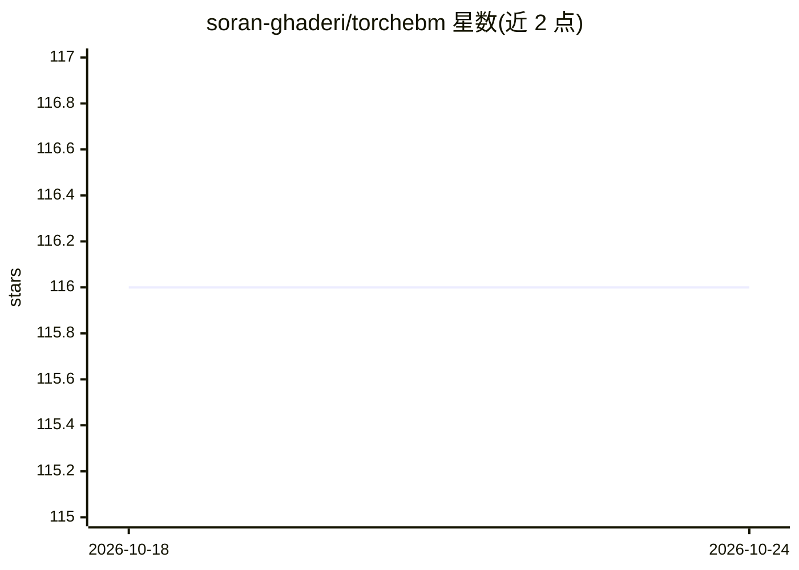

# soran-ghaderi/torchebm

⭐ 116 · Python · MIT · 推送 2026-10-11 · [GitHub](https://github.com/soran-ghaderi/torchebm) · [官网](https://soran-ghaderi.github.io/torchebm/) · 个人维护

**PyTorch 生成式建模库：EBM、扩散、流匹配的统一原语**

基于 PyTorch 的 GPU 优先生成式建模库，用一组可组合原语（能量/场、interpolant、耦合、目标函数、采样器、积分器）统一实现能量基模型、扩散、流匹配、平衡匹配与薛定谔桥等方法。simulation-free 目标使训练像监督学习一样扩展，采样型目标（对比散度）带 MCMC 可选保留。提供 Langevin/HMC 等采样器、多族数值积分器、OT 耦合、合成数据集与 CUDA 混合精度支持，面向复现与实现生成模型方法的研究者和开发者。

## 筛选速览

| 维度 | 判定 | 备注 |
|---|---|---|
| AI 角色 | `ai-native` | 本体是模型或模型工具 |
| 许可风险 | `permissive` | MIT |
| 部署形态 | `library` | 以包/库形式分发 |
| 模型依赖 | — | README 未给出锁定关系 |
| 硬件要求 | — | 无带数字的原话,不猜 |
| 安装摩擦 | `medium` | 含编译或系统依赖之一 |
| 成熟度 | — | 结构信号不足 |

## 能力要点

- 可组合原语：更换配置即可切换流匹配/对比散度/平衡匹配等方法
- Langevin、HMC、FlowSampler（ODE/SDE 模式）等采样器与可插拔积分器
- Sinkhorn/ExactOT/Reflow 等最优传输耦合
- 八种带已知统计的能量模型与合成 2D 基准数据集

## 适用场景

- 研究者在统一框架下训练与对比 EBM、扩散、流匹配方法
- 复现 Equilibrium Matching、Energy Matching 等论文方法
- 为自定义能量或场模型配备 MCMC 采样与积分器

## 场景标签

 · 领域:机器学习/生成式建模

## 证据(README 行号)

> L35: TorchEBM is a PyTorch library for simulation-free, GPU-first generative modeling: scalable, stable training of mode
> L37: TorchEBM takes the statistical-mechanics view of generative modeling. A system is described by a scalar potential $

## 星数曲线

2026-10-18 116 → 2026-10-24 116（+0）

---
*卡片 v1 · prompt 1.4 · 生成 2026-10-23 · 置信度 high · 依据 README sha `11f522348cee` · [字段定义](../../DATASET.md)*
